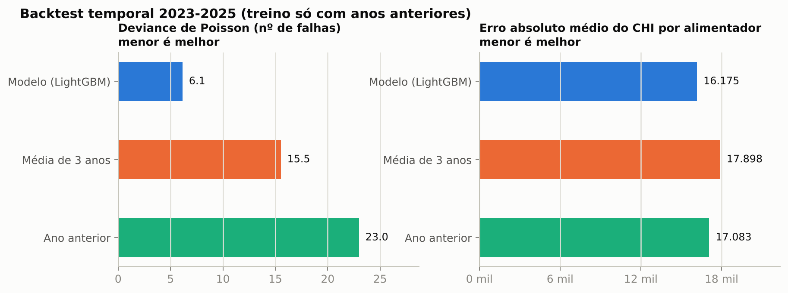
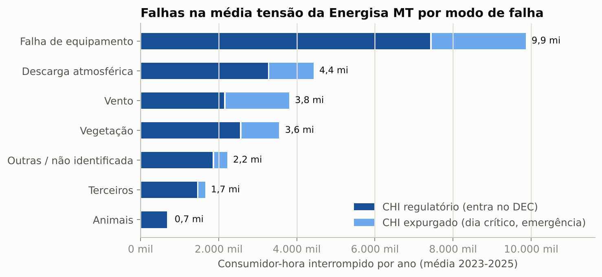
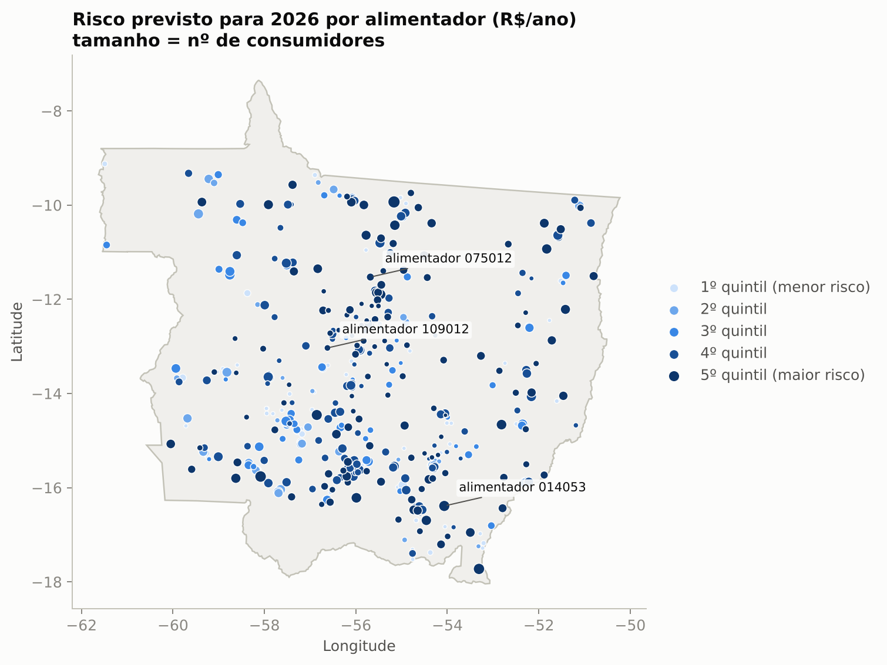
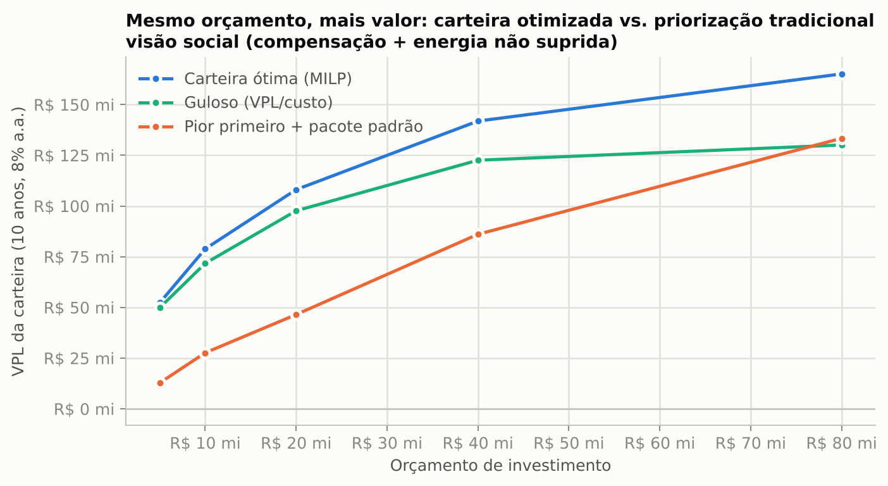

# Gestão de ativos baseada em risco na distribuição de energia

**Onde investir primeiro para reduzir DEC, FEC e compensações, com orçamento limitado?**

Este projeto responde a essa pergunta para a **Energisa Mato Grosso** (697 alimentadores, ~2 milhões de
unidades consumidoras e 900 mil km² de área de concessão), usando apenas dados abertos:

> **Estado da validação (nov/2026):** resultados reproduzidos do zero a partir das fontes brutas, com cortes
> temporais (*point-in-time*) em todas as etapas. Para prever o ano *y*, o cadastro e o vínculo de circuitos
> usam só snapshots da BDGD até 31/12 de *y-1* (testes em [`tests/test_features.py`](tests/test_features.py)).
> O clima do INMET foi testado com uma regra definida antes do resultado
> ([`docs/preregistro_clima.md`](docs/preregistro_clima.md)) e **piorou** o backtest, então o modelo publicado
> não o usa; ver [Robustez](#6-robustez-dos-resultados). A carteira é uma simulação sob premissas
> ilustrativas, não um ganho observado em campo.

| Fonte | O que entra | Período |
|---|---|---|
| ANEEL: Interrupções nas Redes de Distribuição | 2,4 milhões de interrupções com causa, duração e alimentador | 2018 a jul/2026 |
| ANEEL: BDGD (PRODIST Módulo 10) | Cadastro georreferenciado da rede: 2,1 mi segmentos MT, 273 mil trafos, 372 mil chaves | 8 snapshots anuais (2018 a 2025) |
| ANEEL: Indicadores de continuidade e compensações | DEC/FEC oficiais e R$ pagos por violação de DIC/FIC/DMIC/DICRI | 2020 a 2026 |
| INMET: estações automáticas | Chuva, rajadas e temperatura horárias de 45 estações em MT (testadas; fora do modelo) | 2018 a 2025 |

**Para quem decide:** o que muda na prática, o que se ganha e como adotar estão em
[Na prática](#na-prática-o-que-muda-para-quem-decide). A metodologia completa está em
[`docs/metodologia.md`](docs/metodologia.md).

O pipeline vai do dado bruto à **carteira de investimento ótima**:

```
interrupções ─┐
BDGD (8 anos) ─┼─► painel alimentador × ano × modo de falha ─► LightGBM (Poisson / Tweedie) ─► E[falhas], E[CHI] em 2026
INMET (opc.) ─┘                                                                                │
compensações ANEEL ─► R$/CHI por alimentador ─────────────────────────────────────────────────► risco em R$/ano
catálogo de intervenções (custo, eficácia, vida útil) ────► programação inteira (mochila de escolha múltipla) ─► carteira ótima
```

## Resultados

### 1. A base reproduz o DEC oficial
Antes de modelar, recalculei o DEC e o FEC da distribuidora a partir das interrupções individuais, aplicando
as regras de expurgo e de duração mínima de 3 minutos. O resultado bate com o publicado pela ANEEL
(correlação de 1,0 por conjunto e mês):

| Ano | DEC oficial | DEC recalculado | FEC oficial | FEC recalculado |
|---|---|---|---|---|
| 2022 | 16,72 | 16,74 | 7,31 | 7,32 |
| 2023 | 16,16 | 16,17 | 6,83 | 6,84 |
| 2024 | 15,12 | 15,14 | 6,49 | 6,49 |
| 2025 | 14,45 | 14,50 | 6,43 | 6,45 |

### 2. Comparação com baselines de planejamento
Backtest temporal com origem móvel: para prever 2023, o modelo só vê dados até 2022, e assim por diante.
As características cadastrais e o vínculo histórico de circuitos usam apenas snapshots da BDGD até 31/12 do
ano anterior.



| Métrica (média 2023-2025) | Modelo | Média de 3 anos | Ano anterior |
|---|---|---|---|
| Deviance de Poisson (nº de falhas por alimentador e modo) | **6,1** | 15,5 | 23,0 |
| Erro absoluto do CHI por alimentador | **16,2 mil** | 17,9 mil | 17,1 mil |
| Correlação de Spearman do ranking de CHI | **0,91** | 0,88 | 0,89 |
| CHI capturado pelos 10% de alimentadores priorizados | 46% | 46% | 45% |

**O que isso significa:** para saber *quais* alimentadores são os piores, o histórico já resolve quase tudo
(Spearman de 0,89). O modelo ganha onde o histórico não ajuda: em dizer **qual modo de falha** vai pesar em
cada alimentador (deviance de Poisson 2,5 vezes menor que a da média de 3 anos), que é o que define se a obra certa é religador,
rede compacta, poda ou para-raios.

O ganho grande está na granularidade **alimentador × modo de falha**, que é o que define a intervenção
certa. No ranking total de alimentadores, o histórico já é um baseline forte, e o modelo fica só um pouco à
frente. O total anual do sistema oscila entre -18% e +13% de um ano para outro por causa do clima, que não é conhecido
na hora de planejar. Por isso o modelo é usado para **priorizar**, não para prever o DEC do ano.
A calibração por decil de risco está em [`reports/figures/06_calibracao.png`](reports/figures/06_calibracao.png).

### 3. Onde está o risco


* **Falha de material ou equipamento** responde por ~38% do CHI das falhas de MT (2023-2025).
* **26% do CHI é expurgado** (dias críticos e situações de emergência). No modo **vento**, a fração
  expurgada chega a **44%**. Esse CHI pesa para o cliente, mas não entra no DEC nem gera compensação.
  O modelo trata as duas contas separadamente.
* **10% dos alimentadores concentram 46% do risco monetizado** previsto para 2026.



### 4. Comparação de carteiras sob premissas ilustrativas
Para cada alimentador, o otimizador avalia todos os pacotes de até 3 intervenções (religador, automação
FLISR, rede compacta, para-raios, poda e manutenção preditiva). A combinação das eficácias é multiplicativa
por modo de falha. Em seguida, o otimizador escolhe a carteira que maximiza o VPL dentro do orçamento.



Com orçamento de **R$ 20 milhões**, na visão social (compensação + energia não suprida),
a otimização encontra mais que o dobro do VPL da regra tradicional **nas premissas deste cenário**:

| Estratégia | VPL em 10 anos | DEC evitado | Alimentadores tratados |
|---|---|---|---|
| **Carteira ótima (MILP)** | **R$ 108 mi** | 0,77 h | 94 |
| Heurística gulosa (VPL/custo) | R$ 98 mi | 0,80 h | 102 |
| Tradicional: piores alimentadores primeiro + pacote padrão | R$ 46 mi | 0,71 h | 33 |

Na **visão de caixa** (só compensações), apenas ~R$ 21 mi de obras têm VPL positivo; a priorização
tradicional tem VPL praticamente nulo com R$ 40 mi e negativo com R$ 80 mi. Em outras palavras, a compensação regulatória sozinha
não paga a maior parte dos investimentos em confiabilidade, e isso muda a conversa com o regulador.

> **Premissas.** Custos, eficácias e o custo da energia não suprida estão em
> [`configs/intervencoes.yaml`](configs/intervencoes.yaml) e são **ilustrativos**, servem para demonstrar o
> método. O mix ótimo (hoje dominado por religadores e automação) depende diretamente deles e precisa ser
> calibrado com o banco de preços e o histórico de obras da distribuidora.

### 5. Painel interativo
Mapa de risco, ranking de alimentadores e um controle de orçamento que reotimiza a carteira na hora:

```bash
pip install -e ".[app]"
streamlit run app/app.py
```

Para colocar o painel online, ver [Publicar o painel](#publicar-o-painel-streamlit-community-cloud).

### 6. Robustez dos resultados
A primeira versão do pipeline ligava as interrupções aos alimentadores usando também cadastros publicados
depois da data da previsão. Para medir quanto isso inflava o backtest, rodei o mesmo backtest nos dois
painéis, com tudo o mais igual ([`scripts/ablacao_point_in_time.py`](scripts/ablacao_point_in_time.py)):

| Modelo, média 2023-2025 | Sem cortes temporais | Point-in-time |
|---|---|---|
| Deviance de Poisson (falhas) | 6,07 | 6,14 |
| Erro absoluto do CHI por alimentador | 15,8 mil | 16,2 mil |
| Spearman do ranking de CHI | 0,906 | 0,905 |
| CHI capturado pelos 10% priorizados | 45,6% | 46,3% |

O vazamento existia, mas era pequeno: o erro do CHI piora 2,6%, o ranking praticamente não muda e o
modelo continua à frente dos dois baselines. Os baselines quase não mudam, porque só dependem do vínculo
do próprio histórico. O clima do INMET respondia por ~8% da importância SHAP na versão anterior; com os
cortes temporais ele foi testado de novo (abaixo) e não ajudou. Sem ele, o VPL da carteira de R$ 20 mi passou
de R$ 107 mi para R$ 108 mi, e o mix de intervenções se manteve (automação e religadores).

**O clima do INMET ajuda?** Não. Antes de treinar qualquer modelo com ele, fixei a regra em
[`docs/preregistro_clima.md`](docs/preregistro_clima.md): o clima só entraria se melhorasse a deviance e o erro
do CHI em pelo menos 1% (e em mais que 2 desvios-padrão entre sementes) sem piorar o ranking. Resultado de
[`scripts/experimento_clima.py`](scripts/experimento_clima.py), com 10 sementes do LightGBM
([`reports/experimento_clima.json`](reports/experimento_clima.json)):

| Média 2023-2025, 10 sementes | Sem clima | Com clima | Critério |
|---|---|---|---|
| Deviance de Poisson (falhas) | 6,13 | 6,16 | não passou: piora 0,5% |
| Erro absoluto do CHI por alimentador | 16,2 mil | 16,5 mil | não passou: piora 2,0% |
| Spearman do ranking de CHI | 0,906 | 0,902 | não passou: piora além do ruído |
| CHI capturado pelos 10% priorizados | 45,7% | 45,8% | passou: dentro do ruído |

A tabela do clima é a média de 10 sementes sobre os arquivos de 06/11/2026; por isso difere um pouco da
ablação acima (uma semente, execução de 02/11). Com clima, a deviance e o erro do CHI só melhoram em 1 dos 3
anos de teste. O modelo publicado continua sem clima. Uma hipótese, que não testei, é que o histórico de falhas por modo já carrega o que uma climatologia de
5 anos traz; o clima realizado do ano alvo não é conhecido na hora de planejar e por isso não foi usado.

### 7. E se as eficácias forem as medidas nos dados?
A tabela da seção 4 usa eficácias de catálogo. O projeto irmão
[`automation-impact`](https://github.com/CaioNepomuceno2/automation-impact) mediu nos mesmos dados (diferenças
em diferenças) o efeito real de ganhar religadores: **−16,6% no CHI do alimentador** (IC 95%: −24,8% a −7,5%),
contra −22,5% do catálogo. Para o telecomando, o efeito medido foi **nulo** (+1,7%, IC −1,8% a +5,4%), contra
−21% do catálogo. Refiz a carteira de R$ 20 mi com esses valores, mantendo as demais premissas
([`scripts/sensibilidade_eficacias.py`](scripts/sensibilidade_eficacias.py)):

| Visão social, R$ 20 mi | Eficácias de catálogo | Religador medido, telecomando nulo | Religador no limite inferior do IC | Religador no limite superior do IC |
|---|---|---|---|---|
| VPL da carteira ótima | R$ 108 mi | **R$ 53 mi** | R$ 17 mi | R$ 86 mi |
| VPL da regra tradicional | R$ 46 mi | R$ 22 mi | R$ 2 mi | R$ 39 mi |
| Ótima ÷ tradicional | 2,3× | **2,5×** | 7,7× | 2,2× |
| DEC evitado (ótima) | 0,77 h | 0,44 h | 0,20 h | 0,65 h |
| Mix da carteira ótima | automação + religador | só religadores | religadores | só religadores |

**O que isso significa:** com as eficácias medidas, o valor absoluto da carteira cai pela metade e o
telecomando sai da carteira. Mas a vantagem de otimizar sobre a regra tradicional se mantém em todos os
cenários (2,2 a 7,7 vezes), em parte porque a regra tradicional gasta orçamento em telecomando. Na visão de
caixa (só compensações), com as eficácias medidas, só R$ 7,5 mi em obras têm VPL positivo (R$ 3,7 mi de VPL),
e a regra tradicional fica negativa (−R$ 4,0 mi). A lição para o planejamento: **calibrar as eficácias com o
histórico de obras muda a carteira mais do que qualquer melhoria no modelo de previsão.**

## Na prática: o que muda para quem decide

### O problema hoje
O plano de investimento em confiabilidade costuma ser montado com duas regras simples: tratar primeiro os
alimentadores com pior histórico e aplicar um pacote padrão (religador + automação), com eficácias de
catálogo. Nos dados da Energisa MT, essa regra entrega **menos da metade do valor** da carteira otimizada
com o mesmo orçamento (R$ 46 mi contra R$ 108 mi de VPL com as eficácias de catálogo; R$ 22 mi contra
R$ 53 mi com as eficácias medidas). Ela também concentra o dinheiro em poucos alimentadores (33, contra 74 a
94 na carteira ótima) e não diferencia o modo de falha: um alimentador que cai por vegetação recebe a mesma
obra de um que cai por descarga atmosférica.

### O que se ganha

| Ganho | Quanto | De onde vem o número |
|---|---|---|
| Saber onde está o risco | 10% dos 697 alimentadores concentram 46% do risco em R$; 20% concentram 66% | **Medido** (previsão 2026 do modelo validado em backtest), `reports/resumo_decisao.json` |
| Tamanho do problema | R$ 35 mi/ano de risco em compensações e R$ 153 mi/ano na visão social; 8,5 h de DEC previsto por falhas de MT | **Medido** + R$/CHI empírico das compensações; a visão social depende do custo da energia não suprida (premissa) |
| Mais valor pelo mesmo orçamento | 2,2 a 7,7 vezes o VPL da regra tradicional | **Simulação**: o fator se repete em todos os cenários de eficácia testados; o valor absoluto depende das premissas (seções 4 e 7) |
| Obra certa para o modo de falha | deviance de Poisson 2,5 vezes menor que a da média de 3 anos na previsão de falhas por modo | **Medido** no backtest 2023-2025 |
| Plano defensável | cada alimentador da carteira tem previsão, R$/CHI, pacote e VPL rastreáveis | Saídas em `reports/carteira_20M_*.csv` e no painel |

### Por que aplicar
* **Compensação pesa no caixa.** As compensações por violação de DIC/FIC/DMIC/DICRI são pagas todo ano e
  aparecem nos dados abertos da ANEEL. Priorizar pelo R$/CHI de cada conjunto direciona a obra para onde ela
  reduz pagamento, e não só DEC.
* **A compensação sozinha não paga a obra.** Na visão de caixa, só uma fração pequena dos investimentos se paga
  (R$ 21 mi com as eficácias de catálogo; R$ 7,5 mi com as medidas). Isso é um argumento quantitativo para
  discutir com a diretoria e com o regulador o valor social da confiabilidade, em vez de defender obra por obra.
* **Metas de continuidade.** Os limites de DEC/FEC por conjunto são definidos pela ANEEL. Saber quais modos de
  falha vão pesar em quais alimentadores ajuda a escolher a obra que move o indicador do conjunto.
* **Risco de não fazer.** Sem calibrar as eficácias, o plano pode superestimar o retorno: com as eficácias de
  catálogo, a carteira vale o dobro do que vale com as eficácias medidas, e o telecomando entra sem evidência
  de efeito nos dados.

### Como aplicar (roteiro de adoção)
1. **Trocar os dados abertos pelos internos.** As interrupções e a BDGD públicas podem ser substituídas pela
   base de ocorrências do OMS/ADMS e pelo GIS da própria distribuidora, sem mudar o modelo: basta gerar os
   mesmos Parquets intermediários (`data/interim/interrupcoes_*.parquet` e `bdgd_feeders_*.parquet`, ver
   `src/gridrisk/ingest/`). A telemetria de religadores e subestações (SCADA) entra como features novas no
   painel (`features.py`), por exemplo nº de atuações e disponibilidade de comunicação por alimentador.
2. **Calibrar as premissas.** Os custos vêm do banco de preços de obras e as eficácias, do histórico de obras
   executadas: o mesmo método de diferenças em diferenças do `automation-impact` vale para rede compacta,
   para-raios e poda. Tudo entra em [`configs/intervencoes.yaml`](configs/intervencoes.yaml).
3. **Piloto com grupo de controle.** Aplicar a carteira em parte dos alimentadores elegíveis e manter
   alimentadores parecidos sem obra no mesmo período. KPI: CHI e compensação por alimentador, 12 a 24 meses
   depois, comparados por diferenças em diferenças.
4. **Rotina.** Rodar o pipeline uma vez por ano, no ciclo do plano de investimentos, e reavaliar a previsão a
   cada trimestre. Quem usa: planejamento (carteira), manutenção (poda e preditiva por modo de falha),
   regulação (R$ de compensação em risco). Os Parquets de `data/processed/` alimentam direto um painel em
   Power BI; o Streamlit de `app/` já mostra o mapa e reotimiza por orçamento.
5. **Critério de sucesso do piloto.** Redução de CHI nos alimentadores tratados maior que nos controles, dentro
   do intervalo previsto pela carteira, e custo realizado próximo do orçado.

### Limites de uso
* **O VPL não é orçamento.** Os custos e eficácias são ilustrativos; o VPL serve para comparar estratégias, não
  para aprovar verba.
* **O modelo prioriza, não prevê o DEC do ano.** O total do sistema varia de −18% a +13% por causa do clima.
* **Efeito médio não é efeito em cada alimentador.** As eficácias medidas são médias; em alimentadores muito
  diferentes dos usados na estimativa, o efeito pode ser outro.
* **Uma carteira por ano.** O otimizador não modela sequência de obras nem restrições de equipe e material.

## Metodologia em resumo
1. **Painel** alimentador × ano × modo de falha (7 modos), montado só com informação disponível em 31/12 do
   ano anterior.
2. **Previsão** do nº de falhas (LightGBM Poisson) e do CHI (LightGBM Tweedie), validada em backtest de origem
   móvel contra dois baselines de planejamento.
3. **Monetização**: R$/CHI de cada alimentador a partir das compensações pagas nos conjuntos (visão de caixa) e
   da energia não suprida (visão social).
4. **Otimização**: todos os pacotes de até 3 intervenções por alimentador, escolhidos por programação inteira
   para maximizar o VPL dentro do orçamento.

Detalhes, fórmulas, premissas e como interpretar cada resultado: [`docs/metodologia.md`](docs/metodologia.md).

## Decisões de dados que fazem diferença
Os detalhes estão em [`docs/dados.md`](docs/dados.md). Os principais:

* **Dois layouts de interrupções.** De 2018 a 2025, a causa vem concatenada e o expurgo vem como código
  numérico sem domínio publicado. Em 2026, os mesmos campos vêm por extenso. **Inferi o domínio dos códigos
  de expurgo** comparando o perfil de cada código com o layout novo, e a validação contra o DEC oficial
  confirma o mapeamento.
* **IDs de circuito instáveis.** O `COD_ID` dos alimentadores na BDGD mudou entre 2022 e 2023, e o modelo
  antigo da BDGD (M10, até 2020) usa outros nomes de camadas e campos. A chave estável é o código
  operacional (`CTMT.NOME`, ex. `013014`). Um mesmo CTMT pode agrupar vários códigos operacionais, e o
  vínculo é recuperado por `SSDMT.CT_COD_OP`. Com isso, a cobertura do CHI ligado a um alimentador sobe de
  ~75% para 99,9%.
* **A idade cadastral não é idade física.** 7% dos trafos têm a data-padrão 01/01/1980, há um pico de
  35 mil trafos "conectados" em 2017 (recadastramento) e os snapshots antigos trazem datas inválidas.
  **A idade ficou fora do modelo de propósito.**

## Estrutura

```
src/gridrisk/
  config.py               configuração por distribuidora (--config ou GRIDRISK_CONFIG; padrão configs/emt.yaml)
  ingest/interrupcoes.py  download + harmonização dos dois layouts ANEEL, taxonomia de modos de falha
  ingest/bdgd.py          atributos de ativos por alimentador (M10 e V10/V11), mapa de códigos
  ingest/inmet.py         clima horário -> mensal -> IDW no centróide do alimentador
  ingest/continuidade.py  DEC/FEC oficiais e compensações, sem as linhas repetidas da ANEEL
  regra_clima.py          regra de decisão pré-registrada do clima
  features.py             painel alimentador × ano × modo, sem vazamento temporal
  model.py                LightGBM Poisson/Tweedie, backtest, baselines, calibração
  risco.py                R$/CHI (compensações + custo social)
  otimizacao.py           pacotes de intervenção, MILP, baselines guloso e tradicional
scripts/                  build_interrupcoes, build_bdgd, build_clima, run_pipeline, make_figures, validate_dec, experimento_clima,
                          diagnostico_bdgd, diagnostico_vinculo, diagnostico_duplicatas, variacao_sementes (todos com --config)
app/app.py                painel Streamlit (lê só os Parquet de app/data/ e, para MS, de app/data/ems/)
requirements.txt          dependências mínimas do painel publicado (Python 3.12)
.streamlit/config.toml    tema neutro e telemetria desligada
configs/                  recorte por distribuidora (emt.yaml, ems.yaml) e catálogo de intervenções
docs/                     metodologia, decisões de dados e model card; MS: decisoes_ems, resultados_ems, saidas_ems; guarda_mt
```

## Reproduzir

```bash
pip install -e ".[dev]"
python scripts/build_interrupcoes.py   # ~2 GB de Parquet da ANEEL
python scripts/build_bdgd.py           # 8 snapshots BDGD (~1 GB cada, processados e apagados um a um)
python scripts/build_continuidade.py   # DEC/FEC oficiais e compensações pagas (ANEEL)
python scripts/build_clima.py          # INMET (só para o experimento; o modelo só usa clima com modelo.usar_clima: true)
python scripts/validate_dec.py         # confere a base contra o DEC oficial
python scripts/experimento_clima.py    # o clima do INMET ajuda? 10 sementes, regra pré-registrada
python scripts/run_pipeline.py         # backtest, previsão 2026, SHAP, risco e carteira
python scripts/ablacao_point_in_time.py  # backtest com e sem cortes temporais
python scripts/sensibilidade_eficacias.py  # carteira com as eficácias medidas no automation-impact
python scripts/resumo_decisao.py       # números da seção "Na prática"
python scripts/make_figures.py
pytest
```

Para outra distribuidora, crie um YAML em `configs/` (sigla, código ANEEL, IDs dos snapshots da BDGD e pastas de
saída) e passe `--config` a cada script, por exemplo `python scripts/run_pipeline.py --config configs/ems.yaml`. A
variável de ambiente `GRIDRISK_CONFIG` faz o mesmo. Sem `--config`, vale `configs/emt.yaml`, com os caminhos de
sempre. A Energisa MS está em [Energisa MS](#energisa-ms).

## Energisa MS

O mesmo método, aplicado à **Energisa Mato Grosso do Sul** (código ANEEL 404) com `--config configs/ems.yaml`. Tudo de
MS grava só em `reports/ems/`, `app/data/ems/` e `data/ems/`; os resultados de MT acima não mudaram
([como isso foi conferido](docs/guarda_mt.md)). As decisões de dados foram registradas **antes** dos resultados em
[`docs/decisoes_ems.md`](docs/decisoes_ems.md); a análise completa está em [`docs/resultados_ems.md`](docs/resultados_ems.md).

| Indicador (Energisa MS) | Valor | Arquivo |
|---|---|---|
| Alimentadores, consumidores e rede MT (BDGD de 31/12/2025) | 362, 1,40 milhão e 91,5 mil km | [`resumo_decisao.json`](reports/ems/resumo_decisao.json), [`resultados.json`](reports/ems/resultados.json), [`comparacao_descritiva.csv`](reports/ems/diagnostico/comparacao_descritiva.csv) |
| DEC de 2025: oficial e recalculado das interrupções | 9,13 h e 9,12 h (2022 a 2025 e 2020 batem; **2021 e 2026 não**, por dois meses com problema nos dados) | [`validacao_dec_fec.csv`](reports/ems/validacao_dec_fec.csv) |
| Erro absoluto do CHI por alimentador (backtest 2023-2025): modelo, média de 3 anos, ano anterior | 17,4 mil, 19,8 mil e 20,5 mil | [`backtest_media.csv`](reports/ems/backtest_media.csv) |
| Deviance de Poisson das falhas por modo: modelo e média de 3 anos | 11,2 e 20,7 | [`backtest_media.csv`](reports/ems/backtest_media.csv) |
| Variação entre 10 sementes do LightGBM (erro do CHI) | média 17,5 mil, desvio-padrão 0,1 mil (0,6%) | [`variacao_sementes.json`](reports/ems/variacao_sementes.json) |
| Concentração do risco: 10% e 20% dos alimentadores | 33% e 50% do risco social | [`resumo_decisao.json`](reports/ems/resumo_decisao.json) |
| Risco previsto para 2026: compensações, visão social e DEC | R$ 16,6 mi/ano, R$ 106,0 mi/ano e 5,9 h | [`resumo_decisao.json`](reports/ems/resumo_decisao.json) |
| Carteira de R$ 20 mi, visão social (VPL em 10 anos): ótima, gulosa e tradicional | R$ 58,2 mi (87 alimentadores), R$ 56,9 mi e R$ 44,6 mi (66): ótima 1,3 vez a tradicional | [`fronteira_social.csv`](reports/ems/fronteira_social.csv) |
| Visão de caixa (só compensações): obras com VPL positivo | R$ 3,8 mi (24 alimentadores), VPL de R$ 1,4 mi; a regra tradicional dá VPL negativo | [`fronteira_compensacao.csv`](reports/ems/fronteira_compensacao.csv) |

Duas diferenças em relação a MT que mudam a leitura: **59% do CHI das falhas de MS é expurgado** (26% em MT), e a
vantagem da carteira ótima sobre a regra tradicional é de 1,3 vez (2,3 vezes em MT) e cai para 1,03 vez com R$ 40 mi de
orçamento (a ótima para de investir em R$ 31,8 mi). A checagem parcial de 2026 também é mais fraca (Spearman 0,66 contra 0,83), com um mês faltando nos dados
(março). Custos e eficácias são as mesmas premissas ilustrativas de MT, **sem calibração para MS**, e a sensibilidade
com eficácias medidas não foi feita (depende do `automation-impact` em MS). O painel (`streamlit run app/app.py`) tem
um seletor MT/MS. O clima do INMET não roda em MS.

> Projeto independente, sem vínculo com a Energisa ou com a ANEEL. Só dados abertos (ANEEL e IBGE).

## Publicar o painel (Streamlit Community Cloud)
O repositório já está pronto para publicar o painel. **Ainda não foi publicado:** falta só o login do dono.

O que já está no repositório:
* [`requirements.txt`](requirements.txt) com só o que o painel importa (Streamlit, Plotly, pandas, NumPy,
  PyArrow, PuLP, PyYAML e DuckDB), em versões testadas com Python 3.12 num ambiente virtual limpo. O painel
  não precisa instalar o pacote `gridrisk`: `app/app.py` usa a pasta `src/` quando o pacote não está instalado.
* `app/data/`, com os 4 Parquet que o painel lê (1,9 MB), já versionados no git. O repositório inteiro tem
  cerca de 8 MB (arquivos e histórico), muito abaixo de 1 GB.
* [`.streamlit/config.toml`](.streamlit/config.toml): tema claro neutro, sem telemetria e sem abrir navegador.

Passos, logado no GitHub como dono do repositório:
1. Abra <https://share.streamlit.io> e entre com a conta do GitHub `CaioNepomuceno2`. Autorize o acesso ao
   repositório quando o GitHub pedir (ele é público).
2. Clique em **Create app** e escolha **Deploy a public app from GitHub**.
3. Preencha:
   * **Repository:** `CaioNepomuceno2/distribution-asset-risk`
   * **Branch:** `main`
   * **Main file path:** `app/app.py`
   * **App URL:** um nome livre, por exemplo `distribution-asset-risk`.
4. Abra **Advanced settings** e escolha **Python version: 3.12**. Não há *secrets* para preencher.
5. Clique em **Deploy**. A primeira instalação leva alguns minutos.
6. Cole a URL final do painel no topo deste README (ela só existe depois do deploy).

Para atualizar o painel: rode `python scripts/run_pipeline.py`, que regrava `app/data/`, e envie o commit
para a `main`. O Community Cloud reinstala sozinho. Se o painel ficar sem acessos por um tempo, a plataforma
pode pô-lo em repouso; é só abrir a URL de novo.

Teste local do mesmo ambiente do Cloud (sem instalar o pacote):

```bash
python -m venv .venv-painel
.venv-painel/bin/pip install -r requirements.txt    # no Windows: .venv-painel\Scripts\pip
.venv-painel/bin/streamlit run app/app.py
```

## Limitações
* **Clima do INMET testado e fora do modelo:** com a regra pré-registrada em
  [`docs/preregistro_clima.md`](docs/preregistro_clima.md), as colunas de clima pioraram o backtest (seção 6).
  O código de clima respeita os cortes temporais (coordenadas do snapshot *y-1*). Para ligá-lo, rode
  `build_clima.py` e troque `modelo.usar_clima` em `configs/emt.yaml`; só ter o arquivo não liga o clima.
* **O modelo varia de uma semente para outra.** Mudar a semente do LightGBM, ou a ordem das linhas do painel,
  move o erro do CHI em ~0,4% (desvio-padrão de 10 sementes: 62 CHI em 16,2 mil). Reproduzir em outra máquina
  pode mudar o último dígito das métricas do modelo. Razões entre carteiras com denominador pequeno, como o
  7,7× do cenário pessimista da seção 7 (a regra tradicional vale só R$ 2 mi), mexem mais do que o último dígito.
* As eficácias das intervenções são premissas de engenharia. Para religador e telecomando, o
  [`automation-impact`](https://github.com/CaioNepomuceno2/automation-impact) já mediu o efeito nos dados, e a
  seção 7 mostra a carteira com esses valores; para as demais intervenções, falta a mesma medição.
* As interrupções de 2026 usam IDs de circuito que ainda não aparecem em nenhuma BDGD publicada (77% de
  cobertura). Por isso 2026 serve só como checagem parcial: Spearman de 0,83 no ranking de jan a jul.
* A compensação média por CHI é uma aproximação linear de uma regra não linear (só paga acima dos limites
  individuais).

---
Autor: **Caio Nepomuceno**. Dados públicos da ANEEL e do INMET. Este é um projeto independente, sem
vínculo com a Energisa ou com a ANEEL.
