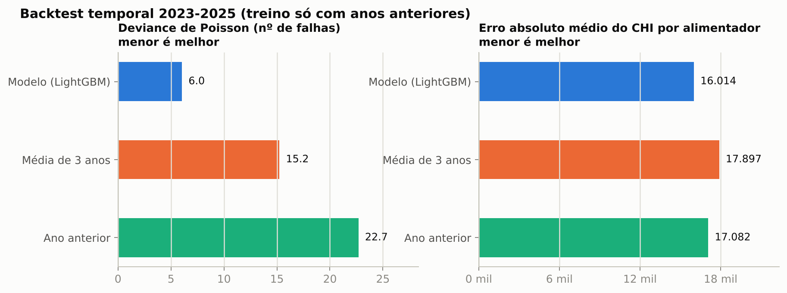
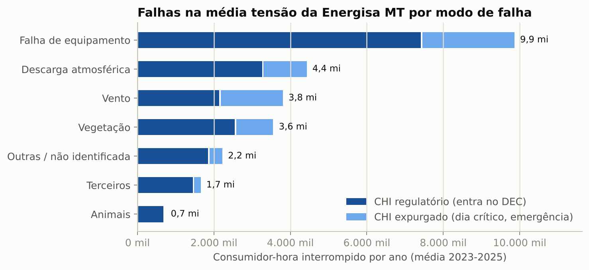
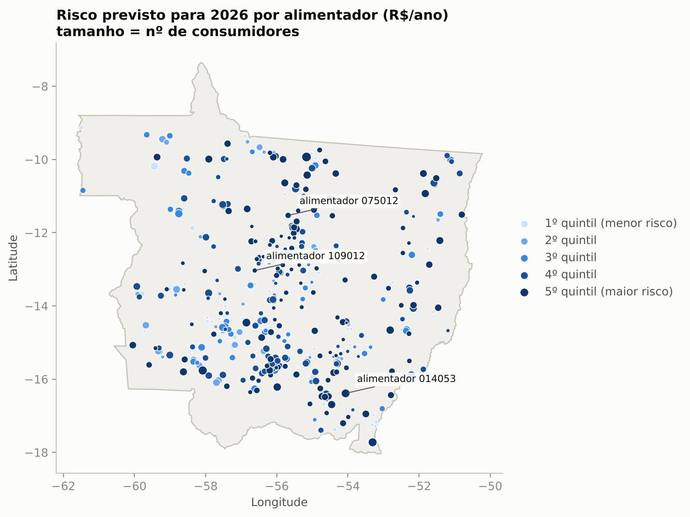
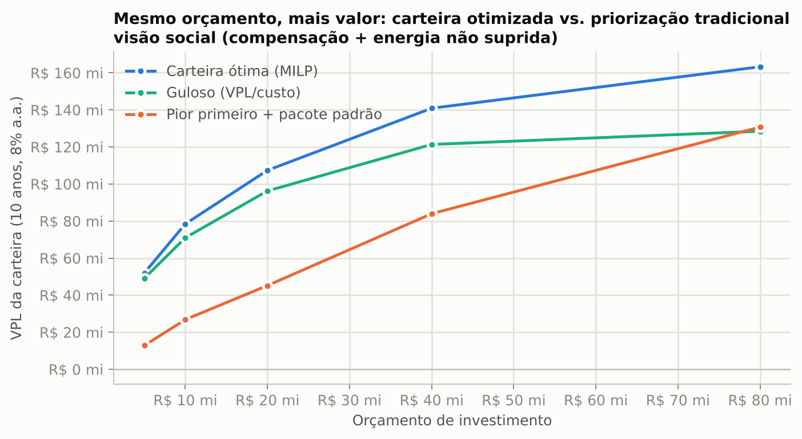

# Gestão de ativos baseada em risco na distribuição de energia

**Onde investir primeiro para reduzir DEC, FEC e compensações, com orçamento limitado?**

Este projeto responde a essa pergunta para a **Energisa Mato Grosso** (697 alimentadores, ~2 milhões de
unidades consumidoras e 900 mil km² de área de concessão), usando apenas dados abertos:

| Fonte | O que entra | Período |
|---|---|---|
| ANEEL: Interrupções nas Redes de Distribuição | 2,4 milhões de interrupções com causa, duração e alimentador | 2018 a jul/2026 |
| ANEEL: BDGD (PRODIST Módulo 10) | Cadastro georreferenciado da rede: 2,1 mi segmentos MT, 273 mil trafos, 372 mil chaves | 8 snapshots anuais (2018 a 2025) |
| ANEEL: Indicadores de continuidade e compensações | DEC/FEC oficiais e R$ pagos por violação de DIC/FIC/DMIC/DICRI | 2020 a 2026 |
| INMET: estações automáticas | Chuva, rajadas e temperatura horárias de 45 estações em MT | 2018 a 2025 |

O pipeline vai do dado bruto à **carteira de investimento ótima**:

```
interrupções ─┐
BDGD (8 anos) ─┼─► painel alimentador × ano × modo de falha ─► LightGBM (Poisson / Tweedie) ─► E[falhas], E[CHI] em 2026
INMET ────────┘                                                                                │
compensações ANEEL ─► R$/CHI por alimentador ─────────────────────────────────────────────────► risco em R$/ano
catálogo de intervenções (custo, eficácia, vida útil) ────► programação inteira (mochila de escolha múltipla) ─► carteira ótima
```

## Resultados

### 1. A base reproduz o DEC oficial
Antes de modelar, recalculei o DEC e o FEC da distribuidora a partir das interrupções individuais, aplicando
as regras de expurgo e de duração mínima de 3 minutos. O resultado bate com o publicado pela ANEEL
(correlação de 1,0 por conjunto e mês):

| Ano | DEC oficial | DEC recalculado | FEC oficial | FEC recalculado |
|---|---|---|---|---|
| 2022 | 16,72 | 16,74 | 7,31 | 7,32 |
| 2023 | 16,16 | 16,17 | 6,83 | 6,84 |
| 2024 | 15,12 | 15,14 | 6,49 | 6,49 |
| 2025 | 14,45 | 14,50 | 6,43 | 6,45 |

### 2. O modelo supera as regras de planejamento usuais
Backtest temporal com origem móvel: para prever 2023, o modelo só vê dados até 2022, e assim por diante.
Cada linha prevista usa o cadastro da BDGD de 31/12 do ano anterior, para não haver vazamento de informação.



| Métrica (média 2023-2025) | Modelo | Média de 3 anos | Ano anterior |
|---|---|---|---|
| Deviance de Poisson (nº de falhas por alimentador e modo) | **6,0** | 15,2 | 22,7 |
| Erro absoluto do CHI por alimentador | **16,0 mil** | 17,9 mil | 17,1 mil |
| Correlação de Spearman do ranking de CHI | **0,90** | 0,89 | 0,89 |

O ganho grande está na granularidade **alimentador × modo de falha**, que é o que define a intervenção
certa. No ranking total de alimentadores, o histórico já é um baseline forte, e o modelo fica só um pouco à
frente. O total anual do sistema oscila entre -19% e +11% de um ano para outro por causa do clima, que não é conhecido
na hora de planejar. Por isso o modelo é usado para **priorizar**, não para prever o DEC do ano.
A calibração por decil de risco está em [`reports/figures/06_calibracao.png`](reports/figures/06_calibracao.png).

### 3. Onde está o risco


* **Falha de material ou equipamento** responde por ~40% do CHI das falhas de MT.
* **26% do CHI é expurgado** (dias críticos e situações de emergência). No modo **vento**, a fração
  expurgada chega a **44%**. Esse CHI pesa para o cliente, mas não entra no DEC nem gera compensação.
  O modelo trata as duas contas separadamente.
* **10% dos alimentadores concentram 46% do risco monetizado** previsto para 2026.



### 4. Mesmo orçamento, mais que o dobro de valor
Para cada alimentador, o otimizador avalia todos os pacotes de até 3 intervenções (religador, automação
FLISR, rede compacta, para-raios, poda e manutenção preditiva). A combinação das eficácias é multiplicativa
por modo de falha. Em seguida, o otimizador escolhe a carteira que maximiza o VPL dentro do orçamento.



Com orçamento de **R$ 20 milhões**, na visão social (compensação + energia não suprida):

| Estratégia | VPL em 10 anos | DEC evitado | Alimentadores tratados |
|---|---|---|---|
| **Carteira ótima (MILP)** | **R$ 107 mi** | 0,76 h | 93 |
| Heurística gulosa (VPL/custo) | R$ 96 mi | 0,76 h | 106 |
| Tradicional: piores alimentadores primeiro + pacote padrão | R$ 45 mi | 0,68 h | 33 |

Na **visão de caixa** (só compensações), apenas ~R$ 21 mi de obras têm VPL positivo, e a priorização
tradicional chega a VPL negativo a partir de R$ 40 mi. Em outras palavras, a compensação regulatória sozinha
não paga a maior parte dos investimentos em confiabilidade, e isso muda a conversa com o regulador.

> **Premissas.** Custos, eficácias e o custo da energia não suprida estão em
> [`configs/intervencoes.yaml`](configs/intervencoes.yaml) e são **ilustrativos**, servem para demonstrar o
> método. O mix ótimo (hoje dominado por religadores e automação) depende diretamente deles e precisa ser
> calibrado com o banco de preços e o histórico de obras da distribuidora.

### 5. Painel interativo
Mapa de risco, ranking de alimentadores e um controle de orçamento que reotimiza a carteira na hora:

```bash
pip install -e ".[app]"
streamlit run app/app.py
```

## Decisões de dados que fazem diferença
Os detalhes estão em [`docs/dados.md`](docs/dados.md). Os principais:

* **Dois layouts de interrupções.** De 2018 a 2025, a causa vem concatenada e o expurgo vem como código
  numérico sem domínio publicado. Em 2026, os mesmos campos vêm por extenso. **Inferi o domínio dos códigos
  de expurgo** comparando o perfil de cada código com o layout novo, e a validação contra o DEC oficial
  confirma o mapeamento.
* **IDs de circuito instáveis.** O `COD_ID` dos alimentadores na BDGD mudou entre 2022 e 2023, e o modelo
  antigo da BDGD (M10, até 2020) usa outros nomes de camadas e campos. A chave estável é o código
  operacional (`CTMT.NOME`, ex. `013014`). Um mesmo CTMT pode agrupar vários códigos operacionais, e o
  vínculo é recuperado por `SSDMT.CT_COD_OP`. Com isso, a cobertura do CHI ligado a um alimentador sobe de
  ~75% para 99,9%.
* **A idade cadastral não é idade física.** 7% dos trafos têm a data-padrão 01/01/1980, há um pico de
  35 mil trafos "conectados" em 2017 (recadastramento) e os snapshots antigos trazem datas inválidas.
  **A idade ficou fora do modelo de propósito.**

## Estrutura

```
src/gridrisk/
  ingest/interrupcoes.py  download + harmonização dos dois layouts ANEEL, taxonomia de modos de falha
  ingest/bdgd.py          atributos de ativos por alimentador (M10 e V10/V11), mapa de códigos
  ingest/inmet.py         clima horário -> mensal -> IDW no centróide do alimentador
  features.py             painel alimentador × ano × modo, sem vazamento temporal
  model.py                LightGBM Poisson/Tweedie, backtest, baselines, calibração
  risco.py                R$/CHI (compensações + custo social)
  otimizacao.py           pacotes de intervenção, MILP, baselines guloso e tradicional
scripts/                  build_interrupcoes, build_bdgd, build_clima, run_pipeline, make_figures, validate_dec
app/app.py                painel Streamlit
configs/                  recorte (distribuidora, anos) e catálogo de intervenções
docs/                     decisões de dados e model card
```

## Reproduzir

```bash
pip install -e ".[dev]"
python scripts/build_interrupcoes.py   # ~2 GB de Parquet da ANEEL
python scripts/build_bdgd.py           # 8 snapshots BDGD (~1 GB cada, processados e apagados um a um)
python scripts/build_clima.py          # INMET
python scripts/validate_dec.py         # confere a base contra o DEC oficial
python scripts/run_pipeline.py         # backtest, previsão 2026, SHAP, risco e carteira
python scripts/make_figures.py
pytest
```

Para outra distribuidora, basta trocar a sigla e os IDs dos snapshots da BDGD em `configs/`.

## Limitações
* As eficácias das intervenções vêm de premissas de engenharia, não de inferência causal sobre os dados.
  Um próximo passo natural é estimar o efeito de obras passadas (religadores instalados entre snapshots da
  BDGD) com diferenças em diferenças.
* As interrupções de 2026 usam IDs de circuito que ainda não aparecem em nenhuma BDGD publicada (77% de
  cobertura). Por isso 2026 serve só como checagem parcial: Spearman de 0,83 no ranking de jan a jul.
* A compensação média por CHI é uma aproximação linear de uma regra não linear (só paga acima dos limites
  individuais).

---
Autor: **Caio Nepomuceno**. Dados públicos da ANEEL e do INMET. Este é um projeto independente, sem
vínculo com a Energisa ou com a ANEEL.
