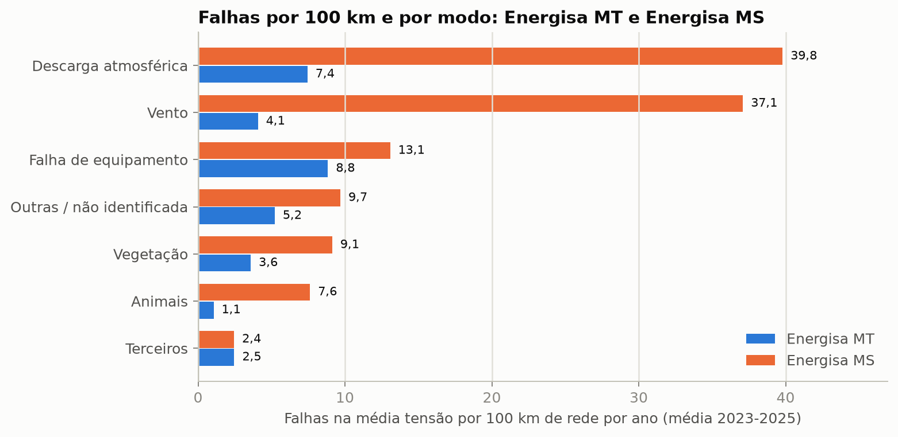
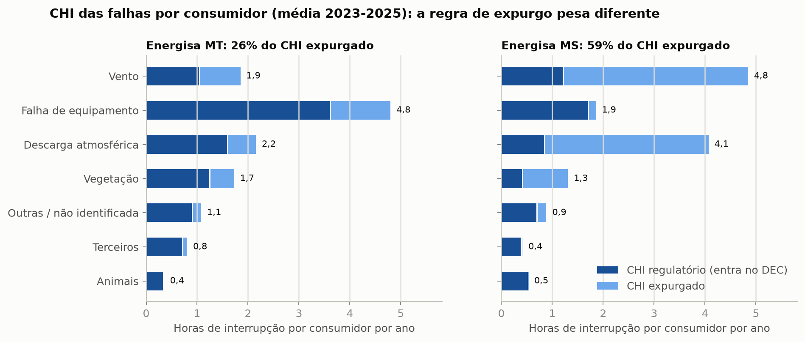
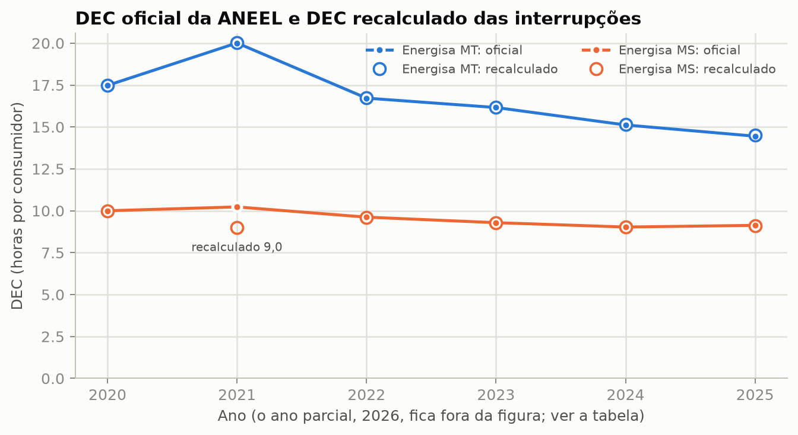
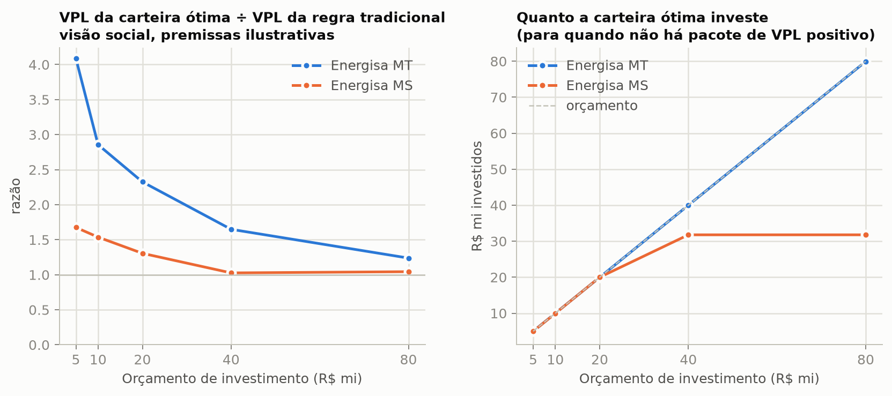

# Comparativo descritivo: Energisa MT × Energisa MS

> Projeto independente, sem vínculo com a Energisa ou com a ANEEL. Só dados abertos (ANEEL e IBGE).

Este documento compara, **só de forma descritiva**, a Energisa Mato Grosso (EMT, "Energisa MT") e a Energisa Mato Grosso do Sul (EMS, "Energisa MS"), com os números por consumidor e por km de rede de média tensão. Ele **não afirma causas**: onde aparece "compatível com", é uma hipótese, e está marcada como tal. Neste texto, "MT" é sempre a empresa Energisa MT; a tensão é escrita "média tensão".

Todo número daqui sai de [`scripts/comparativo_mt_ms.py`](../scripts/comparativo_mt_ms.py), que lê **só arquivos já publicados** (`reports/`, `reports/ems/`, `app/data/` e `app/data/ems/` deste repositório e os `reports/` e `reports/ems/` dos quatro repositórios irmãos). Ele não roda pipeline, não baixa nada e não regenera resultado de MT nem de MS. Quando a métrica comparável não existe nos arquivos publicados, a célula diz "não disponível"; nada foi recalculado por outro caminho. Os CSVs e as figuras ficam em [`reports/comparativo_mt_ms/`](../reports/comparativo_mt_ms/).

## Como ler

* **Razão MS ÷ MT** é o valor da Energisa MS dividido pelo da Energisa MT.
* **Janela.** "Por ano", sem ano, é a média de 2023-2025, a janela dos arquivos publicados. 2026 é parcial; meses com registro de interrupção: Energisa MT, janeiro a julho; Energisa MS, janeiro a fevereiro e abril a julho.
* **Denominadores.** Toda taxa por consumidor ou por km usa o cadastro (BDGD) de 31/12/2025, somado de `risco_alimentador.parquet`. Nas séries por ano o denominador também é o de 2025 (**denominador fixo**).
* **"A diferença pode vir de definição?"** *Não*: mesma definição e mesma origem nos dois lados. *Possível*: há uma diferença documentada que pode mexer no número. *Sim*: a definição é diferente, e a diferença não deve ser lida como diferença de rede.
* **Conferências.** `reports/comparativo_mt_ms/verificacoes.csv` compara 27 números derivados aqui com os publicados em outros arquivos (27 dentro de 1%); `fontes.csv` lista cada arquivo lido, com SHA-256.

## Resumo

| Indicador (descritivo) | Energisa MT | Energisa MS | A diferença pode vir de definição? |
|---|---|---|---|
| Falhas na média tensão por 100 km por ano (média 2023-2025) | 32,7 | 118,8 | Possível: contagem de registros da ANEEL |
| CHI das falhas por consumidor por ano, em horas | 12,8 | 13,9 | Não |
| Fração do CHI das falhas que é expurgada | 26,3% | 58,8% | Sim: regra de expurgo |
| DEC oficial de 2025, em horas | 14,45 | 9,13 | Não |
| Parcela do risco social nos 10% de alimentadores de maior risco | 46,4% | 32,9% | Possível: nº de alimentadores |
| Carteira ótima ÷ regra tradicional (R$ 20 mi, visão social, premissas ilustrativas) | 2,33 | 1,31 | Possível: premissas e cadastro |

Diferenças de definição que mudam a leitura (seção 9): o expurgo pesa muito diferente nas duas empresas; a Energisa MT usa todos os circuitos do cadastro e a Energisa MS exclui os vazios; os meses sem registro de interrupção em 2026 são março na Energisa MS e nenhum na Energisa MT; e o efeito do religador na Energisa MS é o da Energisa MT, não medido (origem_efeito = transportado de MT).

## 1. Tamanho

Cadastro de 31/12/2025. A Energisa MS tem 15,4 consumidores por km de rede de média tensão e a Energisa MT, 9,8 (razão 1,6).

| Métrica | Unidade | Energisa MT | Energisa MS | Razão MS ÷ MT | A diferença pode vir de definição? |
|---|---|---|---|---|---|
| Alimentadores (circuitos de média tensão) no cadastro de 31/12/2025 | alimentadores | 697 | 362 |  | Possível: A Energisa MT conta todos os circuitos do cadastro; o painel da Energisa MS exclui os sem rede e sem consumidor. |
| Circuitos sem rede de média tensão e sem consumidor (2025) | circuitos | 6 | 0 |  | Sim: Entram na contagem de alimentadores da Energisa MT e ficam fora do painel da Energisa MS. |
| Circuitos sem nenhum consumidor (2025) | circuitos | 47 | 13 |  | Não |
| Consumidores | consumidores | 2.055.284 | 1.404.395 |  | Não. Outros repositórios usam o cadastro de 2024 ou outra contagem; ver a seção 9. |
| Rede de média tensão | km | 208.967 | 91.453 |  | Não |
| Consumidores por km de rede de média tensão | consumidores/km | 9,8 | 15,4 | 1,56 | Não |
| Rede de média tensão por alimentador | km | 299,8 | 252,6 | 0,84 | Possível: Muda com a contagem de alimentadores (circuitos vazios). |
| Consumidores por alimentador | consumidores | 2.949 | 3.880 | 1,32 | Possível: Muda com a contagem de alimentadores (circuitos vazios). |

<details>
<summary>Definições, numerador, denominador e arquivos de origem</summary>

| Métrica | Definição | Numerador | Denominador | Arquivo (Energisa MT) | Arquivo (Energisa MS) |
|---|---|---|---|---|---|
| Alimentadores (circuitos de média tensão) no cadastro de 31/12/2025 | Linhas de risco_alimentador (um alimentador por linha). | Contagem de alimentadores | — | distribution-asset-risk/app/data/risco_alimentador.parquet | distribution-asset-risk/app/data/ems/risco_alimentador.parquet |
| Circuitos sem rede de média tensão e sem consumidor (2025) | Circuitos do cadastro de 2025 com 0 km de rede e 0 consumidor. | Contagem de circuitos vazios | — | distribution-asset-risk/reports/ems/diagnostico/circuitos_vazios.csv | distribution-asset-risk/reports/ems/diagnostico/circuitos_vazios.csv |
| Circuitos sem nenhum consumidor (2025) | Circuitos do cadastro de 2025 com 0 consumidor (podem ter rede). | Contagem de circuitos sem consumidor | — | distribution-asset-risk/reports/ems/diagnostico/circuitos_vazios.csv | distribution-asset-risk/reports/ems/diagnostico/circuitos_vazios.csv |
| Consumidores | Soma de n_uc dos alimentadores (cadastro de 31/12/2025). | Σ n_uc | — | distribution-asset-risk/app/data/risco_alimentador.parquet | distribution-asset-risk/app/data/ems/risco_alimentador.parquet |
| Rede de média tensão | Soma de rede_mt_km dos alimentadores (cadastro de 2025). | Σ rede_mt_km | — | distribution-asset-risk/app/data/risco_alimentador.parquet | distribution-asset-risk/app/data/ems/risco_alimentador.parquet |
| Consumidores por km de rede de média tensão | Consumidores divididos pela rede de média tensão. | Consumidores | km de rede de média tensão | distribution-asset-risk/app/data/risco_alimentador.parquet | distribution-asset-risk/app/data/ems/risco_alimentador.parquet |
| Rede de média tensão por alimentador | Média por alimentador. | km de rede | Alimentadores | distribution-asset-risk/app/data/risco_alimentador.parquet | distribution-asset-risk/app/data/ems/risco_alimentador.parquet |
| Consumidores por alimentador | Média por alimentador. | Consumidores | Alimentadores | distribution-asset-risk/app/data/risco_alimentador.parquet | distribution-asset-risk/app/data/ems/risco_alimentador.parquet |

</details>

## 2. Falhas na média tensão por 100 km, por ano e por modo de falha

Falha = registro da ANEEL de interrupção interna, não programada, em média tensão, ligado a um circuito da BDGD. Média anual de 2023-2025. Por 100 km, a Energisa MS tem 118,8 e a Energisa MT, 32,7 falhas por ano (razão 3,6). Por mil consumidores, 77,4 e 33,2.

| Métrica | Unidade | Energisa MT | Energisa MS | Razão MS ÷ MT | A diferença pode vir de definição? |
|---|---|---|---|---|---|
| Falhas na média tensão por 100 km por ano (média 2023-2025) | falhas/100 km/ano | 32,7 | 118,8 | 3,64 | Possível: É contagem de registros, não de eventos; não medi se as duas distribuidoras registram da mesma forma. |
| Falhas na média tensão por mil consumidores por ano (média 2023-2025) | falhas/mil consumidores/ano | 33,2 | 77,4 | 2,33 | Possível: Mesma ressalva dos registros. |
| CHI por registro de falha (média 2023-2025) | consumidor-hora/registro | 384 | 180 | 0,47 | Possível: Depende de como cada distribuidora abre e divide os registros. |

**Por modo de falha** (`falhas_por_modo.csv`; a coluna "publicado" é a taxa do `recloser-performance`, que divide pelo km da topologia reconstruída, e não pelo km do cadastro):

| Modo | Falhas/100 km/ano MT | Falhas/100 km/ano MS | Razão MS ÷ MT | % das falhas MT | % das falhas MS | Publicado MT | Publicado MS |
|---|---|---|---|---|---|---|---|
| Falha de equipamento | 8,8 | 13,1 | 1,5 | 27,0% | 11,0% | 8,9 | 13,1 |
| Descarga atmosférica | 7,4 | 39,8 | 5,3 | 22,8% | 33,5% | 7,5 | 39,8 |
| Vento | 4,1 | 37,1 | 9,1 | 12,5% | 31,2% | 4,1 | 37,1 |
| Vegetação | 3,6 | 9,1 | 2,5 | 11,0% | 7,7% | 3,6 | 9,1 |
| Animais | 1,1 | 7,6 | 7,2 | 3,2% | 6,4% | 1,1 | 7,6 |
| Terceiros | 2,5 | 2,4 | 1,0 | 7,5% | 2,1% | 2,5 | 2,4 |
| Outras / não identificada | 5,2 | 9,7 | 1,9 | 16,0% | 8,1% | 5,3 | 9,7 |
| Total | 32,7 | 118,8 | 3,6 | 100,0% | 100,0% | 32,9 | 118,8 |



**A diferença pode vir de definição?** Possível. A contagem é de registros da ANEEL, não de eventos (seção 9); a rede e os consumidores são os do mesmo cadastro nas duas empresas.

**Por ano** (`falhas_por_ano.csv`): todas as falhas de média tensão de cada ano, ligadas ou não a um circuito, com **denominador fixo de 2025**. 2026 é parcial.

| Ano | Falhas/100 km MT | Falhas/100 km MS | CHI/consumidor MT (h) | CHI/consumidor MS (h) | CHI por registro MT | CHI por registro MS |
|---|---|---|---|---|---|---|
| 2018 | 36,2 | 93,5 | 15,8 | 12,1 | 430 | 198 |
| 2019 | 36,8 | 97,7 | 18,5 | 13,2 | 495 | 208 |
| 2020 | 31,7 | 92,2 | 13,9 | 13,4 | 431 | 223 |
| 2021 | 33,7 | 80,8 | 16,2 | 10,3 | 474 | 195 |
| 2022 | 33,6 | 102,0 | 13,7 | 12,1 | 403 | 182 |
| 2023 | 34,5 | 104,7 | 14,2 | 12,8 | 404 | 187 |
| 2024 | 30,2 | 122,4 | 12,0 | 13,9 | 391 | 175 |
| 2025 | 33,6 | 129,4 | 12,1 | 15,0 | 355 | 178 |
| 2026 (parcial) | 17,2 | 113,0 | 5,2 | 6,5 | 296 | 88 |

**A diferença pode vir de definição?** Possível, pelo mesmo motivo (registros). O número de falhas conta **registros** do arquivo da ANEEL, não eventos físicos; se as duas distribuidoras registram e dividem as ocorrências do mesmo jeito, é uma pergunta em aberto (seção 9).

A série **por ano e por modo** ao mesmo tempo não está publicada para a Energisa MT: por modo há só a média de 2023-2025, e por ano só o total. Por isso as duas tabelas acima não se cruzam.

<details>
<summary>Definições, numerador, denominador e arquivos de origem</summary>

| Métrica | Definição | Numerador | Denominador | Arquivo (Energisa MT) | Arquivo (Energisa MS) |
|---|---|---|---|---|---|
| Falhas na média tensão por 100 km por ano (média 2023-2025) | Registros da ANEEL de interrupção interna, não programada, em média tensão, ligados a um circuito. | Σ n_falhas por ano (média 2023-2025) | km de rede de média tensão ÷ 100 | recloser-performance/reports/falhas_por_modo.csv; distribution-asset-risk/app/data/risco_alimentador.parquet | recloser-performance/reports/ems/falhas_por_modo.csv; distribution-asset-risk/app/data/ems/risco_alimentador.parquet |
| Falhas na média tensão por mil consumidores por ano (média 2023-2025) | Mesma contagem de falhas, por consumidor. | Σ n_falhas por ano (média 2023-2025) | Consumidores ÷ 1.000 | recloser-performance/reports/falhas_por_modo.csv; distribution-asset-risk/app/data/risco_alimentador.parquet | recloser-performance/reports/ems/falhas_por_modo.csv; distribution-asset-risk/app/data/ems/risco_alimentador.parquet |
| CHI por registro de falha (média 2023-2025) | Consumidor-hora interrompido médio de cada registro de falha. | Σ CHI por ano | Σ n_falhas por ano | recloser-performance/reports/falhas_por_modo.csv | recloser-performance/reports/ems/falhas_por_modo.csv |

</details>

## 3. CHI por consumidor, total e regulatório

CHI é consumidor-hora interrompido. Na média de 2023-2025, as falhas na média tensão somam 13,9 h por consumidor por ano na Energisa MS e 12,8 h na Energisa MT (razão 1,09). O CHI regulatório, o que entra no DEC e nas compensações, é de 5,7 h na Energisa MS e 9,4 h na Energisa MT. A fração expurgada é de 58,8% na Energisa MS e 26,3% na Energisa MT.

> **Ressalva.** A regra de expurgo (dia crítico e situação de emergência) pesa muito diferente nas duas empresas. Por isso o CHI total é a medida mais comparável; o regulatório e a fração expurgada refletem também a definição do que se expurga.

| Métrica | Unidade | Energisa MT | Energisa MS | Razão MS ÷ MT | A diferença pode vir de definição? |
|---|---|---|---|---|---|
| CHI das falhas por consumidor por ano, total (média 2023-2025) | h/consumidor/ano | 12,8 | 13,9 | 1,09 | Não |
| CHI das falhas por consumidor por ano, regulatório (média 2023-2025) | h/consumidor/ano | 9,4 | 5,7 | 0,61 | Sim: A regra de expurgo pesa muito diferente nas duas empresas. |
| Fração do CHI das falhas que é expurgada (média 2023-2025) | % | 26,3% | 58,8% | 2,23 | Sim: A regra de expurgo pesa muito diferente. |
| CHI das falhas por km de rede de média tensão por ano (média 2023-2025) | h/km/ano | 125,6 | 213,5 | 1,70 | Não |

**Por modo de falha** (`chi_por_modo.csv`):

| Modo | CHI total MT (h/consumidor) | CHI total MS | Regulatório MT | Regulatório MS | Expurgado MT | Expurgado MS |
|---|---|---|---|---|---|---|
| Falha de equipamento | 4,80 | 1,86 | 3,61 | 1,70 | 25% | 9% |
| Descarga atmosférica | 2,15 | 4,07 | 1,59 | 0,84 | 26% | 79% |
| Vento | 1,85 | 4,84 | 1,04 | 1,20 | 44% | 75% |
| Vegetação | 1,73 | 1,31 | 1,24 | 0,41 | 28% | 69% |
| Animais | 0,35 | 0,53 | 0,33 | 0,52 | 6% | 2% |
| Terceiros | 0,80 | 0,41 | 0,70 | 0,38 | 13% | 9% |
| Outras / não identificada | 1,08 | 0,88 | 0,90 | 0,69 | 17% | 22% |
| Total | 12,77 | 13,90 | 9,40 | 5,73 | 26% | 59% |



**A diferença pode vir de definição?** Não para o CHI total. Sim para o CHI regulatório e para a parcela expurgada: a regra de expurgo pesa muito diferente nas duas empresas, principalmente nos modos ligados ao tempo (descarga atmosférica, vento e vegetação).

Por ano, só a Energisa MS tem publicada a parcela sem expurgo (`falhas_por_ano.csv`, colunas `chi_sem_expurgo_uc_ms` e `pct_chi_expurgado_ms`); para a Energisa MT a série por ano é não disponível. A fração expurgada da Energisa MS por ano, até 2025: 2018: 42%; 2019: 46%; 2020: 50%; 2021: 41%; 2022: 45%; 2023: 62%; 2024: 54%; 2025: 61%.

<details>
<summary>Definições, numerador, denominador e arquivos de origem</summary>

| Métrica | Definição | Numerador | Denominador | Arquivo (Energisa MT) | Arquivo (Energisa MS) |
|---|---|---|---|---|---|
| CHI das falhas por consumidor por ano, total (média 2023-2025) | Consumidor-hora interrompido (CHI) das falhas, com todo o CHI (inclusive o expurgado). | Σ CHI por ano | Consumidores | recloser-performance/reports/falhas_por_modo.csv; distribution-asset-risk/app/data/risco_alimentador.parquet | recloser-performance/reports/ems/falhas_por_modo.csv; distribution-asset-risk/app/data/ems/risco_alimentador.parquet |
| CHI das falhas por consumidor por ano, regulatório (média 2023-2025) | CHI sem expurgo e com 3 minutos ou mais: o que entra no DEC e nas compensações. | Σ (CHI do modo × fração regulatória do modo), por ano | Consumidores | recloser-performance/reports/falhas_por_modo.csv; distribution-asset-risk/reports/frac_chi_regulatorio_modo.csv; distribution-asset-risk/app/data/risco_alimentador.parquet | recloser-performance/reports/ems/falhas_por_modo.csv; distribution-asset-risk/reports/ems/frac_chi_regulatorio_modo.csv; distribution-asset-risk/app/data/ems/risco_alimentador.parquet |
| Fração do CHI das falhas que é expurgada (média 2023-2025) | 1 − CHI regulatório ÷ CHI total (dia crítico, situação de emergência etc.). | CHI regulatório por ano | CHI total por ano | recloser-performance/reports/falhas_por_modo.csv; distribution-asset-risk/reports/frac_chi_regulatorio_modo.csv | recloser-performance/reports/ems/falhas_por_modo.csv; distribution-asset-risk/reports/ems/frac_chi_regulatorio_modo.csv |
| CHI das falhas por km de rede de média tensão por ano (média 2023-2025) | CHI total das falhas por km de rede. | Σ CHI por ano | km de rede de média tensão | recloser-performance/reports/falhas_por_modo.csv; distribution-asset-risk/app/data/risco_alimentador.parquet | recloser-performance/reports/ems/falhas_por_modo.csv; distribution-asset-risk/app/data/ems/risco_alimentador.parquet |

</details>

## 4. DEC e FEC oficiais e o DEC recalculado

DEC e FEC oficiais vêm dos indicadores coletivos da ANEEL, por consumidor, e são diretamente comparáveis. Em 2025, o DEC é de 9,13 h na Energisa MS e 14,45 h na Energisa MT; o FEC, 4,33 e 6,43. O "recalculado" refaz o DEC das interrupções individuais (sem expurgo e com 3 minutos ou mais). Ele "bate" se difere do oficial em até 1%. Anos em que **não** bate: Energisa MT, nenhum; Energisa MS, 2021, 2026.

| Ano | DEC oficial MT | DEC recalc. MT | Bate MT | DEC oficial MS | DEC recalc. MS | Bate MS | FEC oficial MT | FEC recalc. MT | FEC oficial MS | FEC recalc. MS |
|---|---|---|---|---|---|---|---|---|---|---|
| 2020 | 17,48 | 17,48 | sim | 10,00 | 10,00 | sim | 7,77 | 7,77 | 4,31 | 4,31 |
| 2021 | 20,01 | 20,03 | sim | 10,23 | 9,01 | não | 8,18 | 8,18 | 4,27 | 3,92 |
| 2022 | 16,72 | 16,74 | sim | 9,62 | 9,61 | sim | 7,31 | 7,32 | 4,23 | 4,23 |
| 2023 | 16,16 | 16,17 | sim | 9,29 | 9,28 | sim | 6,83 | 6,84 | 3,99 | 3,99 |
| 2024 | 15,12 | 15,14 | sim | 9,03 | 9,03 | sim | 6,49 | 6,49 | 4,25 | 4,25 |
| 2025 | 14,45 | 14,50 | sim | 9,13 | 9,12 | sim | 6,43 | 6,45 | 4,33 | 4,32 |
| 2026 (parcial) | 7,22 | 7,28 | sim | 4,74 | 3,94 | não | 3,06 | 3,07 | 2,25 | 1,94 |

A correlação mensal por conjunto (um valor único por arquivo, todos os meses) é 1,0000 na Energisa MT e 0,9596 na Energisa MS; sem os meses com problema nos dados de MS (2021/10, 2026/03) ela é 0,9994.

> **Ressalva sobre 2026.** O DEC de 2026 da Energisa MT foi gerado sem alinhar os meses e de um download anterior do arquivo de indicadores (`docs/dados.md`); o da Energisa MS compara só os meses que existem nas interrupções (janeiro a fevereiro e abril a julho). O recorte de meses não é o mesmo, e o nível de 2026 não se compara.



**A diferença pode vir de definição?** Não para o DEC e o FEC oficiais. Sim para o recalculado nos anos que não batem: a base de interrupções da Energisa MS tem meses com problema (seção 9).

| Métrica | Unidade | Energisa MT | Energisa MS | Razão MS ÷ MT | A diferença pode vir de definição? |
|---|---|---|---|---|---|
| DEC oficial de 2025 | h | 14,45 | 9,13 | 0,63 | Não |
| FEC oficial de 2025 | interrupções/consumidor | 6,43 | 4,33 | 0,67 | Não |
| DEC recalculado das interrupções, 2025 | h | 14,50 | 9,12 | 0,63 | Não |
| Anos em que o DEC ou o FEC recalculado difere do oficial em mais de 1% | anos | nenhum | 2021, 2026 |  | Sim: Em 2026 os dois lados cobrem meses diferentes; a Energisa MS tem meses com problema nos dados (seção 4). |
| Correlação mensal por conjunto entre DEC calculado e oficial (todos os meses) | correlação | 1,0000 | 0,9596 |  | Sim: A correlação da Energisa MS é menor; há meses com problema nos dados (seção 4). |

<details>
<summary>Definições, numerador, denominador e arquivos de origem</summary>

| Métrica | Definição | Numerador | Denominador | Arquivo (Energisa MT) | Arquivo (Energisa MS) |
|---|---|---|---|---|---|
| DEC oficial de 2025 | Duração equivalente de interrupção por consumidor, publicada pela ANEEL (todas as interrupções, com a regra de expurgo). | Σ DEC dos conjuntos × consumidores | Consumidores do conjunto | distribution-asset-risk/reports/validacao_dec_fec.csv | distribution-asset-risk/reports/ems/validacao_dec_fec.csv |
| FEC oficial de 2025 | Frequência equivalente de interrupção por consumidor, publicada pela ANEEL. | Σ FEC dos conjuntos × consumidores | Consumidores do conjunto | distribution-asset-risk/reports/validacao_dec_fec.csv | distribution-asset-risk/reports/ems/validacao_dec_fec.csv |
| DEC recalculado das interrupções, 2025 | DEC reconstruído das interrupções individuais, sem expurgo e com 3 minutos ou mais. | Σ CHI dos conjuntos | Consumidores do conjunto | distribution-asset-risk/reports/validacao_dec_fec.csv | distribution-asset-risk/reports/ems/validacao_dec_fec.csv |
| Anos em que o DEC ou o FEC recalculado difere do oficial em mais de 1% | Diferença relativa \|calculado − oficial\| ÷ oficial acima da tolerância. | \|calculado − oficial\| | oficial | distribution-asset-risk/reports/validacao_dec_fec.csv | distribution-asset-risk/reports/ems/validacao_dec_fec.csv |
| Correlação mensal por conjunto entre DEC calculado e oficial (todos os meses) | Valor único do arquivo, repetido em todas as linhas. | — | — | distribution-asset-risk/reports/validacao_dec_fec.csv | distribution-asset-risk/reports/ems/validacao_dec_fec.csv |

</details>

## 5. Compensações por consumidor

**Compensações pagas.** Para a Energisa MS há a série por ano, lida sem as linhas repetidas da ANEEL (o arquivo da ANEEL traz linhas repetidas). Para a Energisa MT **não há série de compensações pagas nos arquivos publicados**: aparece como "não disponível", e não foi recalculada. Média de 2022 a 2025 na Energisa MS: R$ 14,76 por consumidor por ano.

| Ano | R$ pagos MT | R$/consumidor MT | R$ pagos MS | R$/consumidor MS |
|---|---|---|---|---|
| 2020 | não disponível | não disponível | R$ 11,1 mi | 7,92 |
| 2021 | não disponível | não disponível | R$ 13,4 mi | 9,51 |
| 2022 | não disponível | não disponível | R$ 19,1 mi | 13,63 |
| 2023 | não disponível | não disponível | R$ 22,2 mi | 15,77 |
| 2024 | não disponível | não disponível | R$ 18,6 mi | 13,23 |
| 2025 | não disponível | não disponível | R$ 23,0 mi | 16,39 |
| 2026 (parcial) | não disponível | não disponível | R$ 20,7 mi | 14,71 |

**O que existe para as duas empresas** é a previsão do modelo para 2026, que **não é compensação paga**: CHI regulatório previsto vezes o R$ por CHI das compensações de 2022 a 2025. Depende da fração regulatória de cada empresa.

| Métrica | Unidade | Energisa MT | Energisa MS | Razão MS ÷ MT | A diferença pode vir de definição? |
|---|---|---|---|---|---|
| Compensações pagas por consumidor por ano (média 2022-2025) | R$/consumidor/ano | não disponível | 14,76 |  | Não. Para a Energisa MT não há série de compensações pagas nos arquivos publicados. |
| Risco previsto em compensações para 2026 (modelo), por consumidor | R$/consumidor/ano | 17,24 | 11,81 | 0,68 | Possível: Depende da fração regulatória e do R$ por CHI de cada empresa. |

**A diferença pode vir de definição?** Não para o que foi pago (onde existe). Possível para a previsão do modelo: ela usa a fração regulatória e o R$ por CHI de cada empresa.

<details>
<summary>Definições, numerador, denominador e arquivos de origem</summary>

| Métrica | Definição | Numerador | Denominador | Arquivo (Energisa MT) | Arquivo (Energisa MS) |
|---|---|---|---|---|---|
| Compensações pagas por consumidor por ano (média 2022-2025) | Σ dos indicadores PG* da ANEEL por conjunto, lidos sem as linhas repetidas do arquivo. | R$ pagos por ano | Consumidores (cadastro de 2025, denominador fixo) | distribution-asset-risk/app/data/risco_alimentador.parquet | distribution-asset-risk/reports/ems/diagnostico/compensacoes_por_ano.csv; distribution-asset-risk/app/data/ems/risco_alimentador.parquet |
| Risco previsto em compensações para 2026 (modelo), por consumidor | Previsão do modelo: CHI regulatório previsto × R$ por CHI das compensações de 2022-2025. Não é compensação paga. | Σ risco_rs_compensacao | Consumidores | distribution-asset-risk/app/data/risco_alimentador.parquet | distribution-asset-risk/app/data/ems/risco_alimentador.parquet |

</details>

## 6. Concentração do risco

No risco previsto para 2026, os 10% de alimentadores de maior risco social concentram 32,9% do risco na Energisa MS e 46,4% na Energisa MT; os 20%, 50,3% e 66,0%. Os grupos têm 36 e 72 alimentadores na Energisa MS e 70 e 139 na Energisa MT.

| Métrica | Unidade | Energisa MT | Energisa MS | Razão MS ÷ MT | A diferença pode vir de definição? |
|---|---|---|---|---|---|
| Parcela do risco social previsto nos 10% de alimentadores de maior risco | % | 46,4% | 32,9% | 0,71 | Possível: O número de alimentadores muda (circuitos vazios). |
| Parcela do risco social previsto nos 20% de alimentadores de maior risco | % | 66,0% | 50,3% | 0,76 | Possível: O número de alimentadores muda (circuitos vazios). |
| Parcela do risco em compensações nos 10% de alimentadores de maior risco | % | 46,7% | 29,7% | 0,63 | Possível: O número de alimentadores muda (circuitos vazios). |
| Parcela do risco em compensações nos 20% de alimentadores de maior risco | % | 66,4% | 48,3% | 0,73 | Possível: O número de alimentadores muda (circuitos vazios). |
| Risco social previsto para 2026 (modelo), por consumidor | R$/consumidor/ano | 74,2 | 75,5 | 1,02 | Possível: Mesmas premissas nas duas empresas, sem calibrar. |
| DEC previsto para 2026 por falhas na média tensão (modelo) | h | 8,48 | 5,93 | 0,70 | Possível: Depende da fração regulatória (expurgo). |

**A diferença pode vir de definição?** Possível: o número de alimentadores de cada grupo depende da contagem de alimentadores de cada empresa (circuitos vazios).

Conferência com `resumo_decisao.json` (risco social):

| Grupo | Parcela MT (aqui) | Publicada MT | Parcela MS (aqui) | Publicada MS |
|---|---|---|---|---|
| 10% de maior risco social | 46,4% | 46,4% | 32,9% | 32,9% |
| 20% de maior risco social | 66,0% | 66,0% | 50,3% | 50,3% |
| 10% de maior risco em compensações | 46,7% | não disponível | 29,7% | não disponível |
| 20% de maior risco em compensações | 66,4% | não disponível | 48,3% | não disponível |

<details>
<summary>Definições, numerador, denominador e arquivos de origem</summary>

| Métrica | Definição | Numerador | Denominador | Arquivo (Energisa MT) | Arquivo (Energisa MS) |
|---|---|---|---|---|---|
| Parcela do risco social previsto nos 10% de alimentadores de maior risco | Os round(n × 10%) alimentadores de maior risco_rs_social. | Σ risco_rs_social dos 10% de maior risco | Σ risco_rs_social | distribution-asset-risk/app/data/risco_alimentador.parquet | distribution-asset-risk/app/data/ems/risco_alimentador.parquet |
| Parcela do risco social previsto nos 20% de alimentadores de maior risco | Os round(n × 20%) alimentadores de maior risco_rs_social. | Σ risco_rs_social dos 20% de maior risco | Σ risco_rs_social | distribution-asset-risk/app/data/risco_alimentador.parquet | distribution-asset-risk/app/data/ems/risco_alimentador.parquet |
| Parcela do risco em compensações nos 10% de alimentadores de maior risco | Os round(n × 10%) alimentadores de maior risco_rs_compensacao. | Σ risco_rs_compensacao dos 10% de maior risco | Σ risco_rs_compensacao | distribution-asset-risk/app/data/risco_alimentador.parquet | distribution-asset-risk/app/data/ems/risco_alimentador.parquet |
| Parcela do risco em compensações nos 20% de alimentadores de maior risco | Os round(n × 20%) alimentadores de maior risco_rs_compensacao. | Σ risco_rs_compensacao dos 20% de maior risco | Σ risco_rs_compensacao | distribution-asset-risk/app/data/risco_alimentador.parquet | distribution-asset-risk/app/data/ems/risco_alimentador.parquet |
| Risco social previsto para 2026 (modelo), por consumidor | Previsão do modelo: compensação + energia não suprida (custo da energia não suprida: premissa ilustrativa). | Σ risco_rs_social | Consumidores | distribution-asset-risk/app/data/risco_alimentador.parquet | distribution-asset-risk/app/data/ems/risco_alimentador.parquet |
| DEC previsto para 2026 por falhas na média tensão (modelo) | Previsão do modelo para 2026 (CHI regulatório previsto por consumidor). | Σ dec_contribuicao_h | — | distribution-asset-risk/app/data/risco_alimentador.parquet | distribution-asset-risk/app/data/ems/risco_alimentador.parquet |

</details>

## 7. Carteira ótima contra a regra tradicional

Mesmo método e mesmas premissas ilustrativas nas duas empresas (custos, eficácias e energia não suprida do catálogo da Energisa MT, sem calibrar para MS). Com orçamento de R$ 20 mi na visão social, a razão entre o VPL da carteira ótima e o da regra tradicional é de 1,31 na Energisa MS e 2,33 na Energisa MT. A tabela mostra também quanto a carteira ótima de fato investe. A razão só é calculada quando o VPL da regra tradicional passa de R$ 1 mi ("não se aplica" nos demais casos).



| Visão | Orçamento | VPL ótima MT | Investido MT | VPL trad. MT | Razão MT | VPL ótima MS | Investido MS | VPL trad. MS | Razão MS |
|---|---|---|---|---|---|---|---|---|---|
| social | R$ 5 mi | R$ 52,3 mi | R$ 5,0 mi | R$ 12,8 mi | 4,09 | R$ 33,6 mi | R$ 5,0 mi | R$ 20,1 mi | 1,68 |
| social | R$ 10 mi | R$ 78,9 mi | R$ 10,0 mi | R$ 27,6 mi | 2,86 | R$ 46,4 mi | R$ 10,0 mi | R$ 30,2 mi | 1,54 |
| social | R$ 20 mi | R$ 108,1 mi | R$ 20,0 mi | R$ 46,5 mi | 2,33 | R$ 58,2 mi | R$ 20,0 mi | R$ 44,6 mi | 1,31 |
| social | R$ 40 mi | R$ 141,9 mi | R$ 40,0 mi | R$ 86,0 mi | 1,65 | R$ 61,4 mi | R$ 31,8 mi | R$ 59,9 mi | 1,03 |
| social | R$ 80 mi | R$ 165,1 mi | R$ 79,9 mi | R$ 133,4 mi | 1,24 | R$ 61,4 mi | R$ 31,8 mi | R$ 58,9 mi | 1,04 |
| caixa (só compensações) | R$ 5 mi | R$ 8,6 mi | R$ 4,9 mi | R$ 1,9 mi | 4,55 | R$ 1,4 mi | R$ 3,8 mi | R$ -0,2 mi | não se aplica |
| caixa (só compensações) | R$ 10 mi | R$ 11,8 mi | R$ 9,9 mi | R$ 2,4 mi | 5,02 | R$ 1,4 mi | R$ 3,8 mi | R$ -1,2 mi | não se aplica |
| caixa (só compensações) | R$ 20 mi | R$ 13,6 mi | R$ 19,9 mi | R$ 2,8 mi | 4,92 | R$ 1,4 mi | R$ 3,8 mi | R$ -4,9 mi | não se aplica |
| caixa (só compensações) | R$ 40 mi | R$ 13,6 mi | R$ 21,2 mi | R$ 0,1 mi | não se aplica | R$ 1,4 mi | R$ 3,8 mi | R$ -15,9 mi | não se aplica |
| caixa (só compensações) | R$ 80 mi | R$ 13,6 mi | R$ 21,2 mi | R$ -10,1 mi | não se aplica | R$ 1,4 mi | R$ 3,8 mi | R$ -17,3 mi | não se aplica |

**A diferença pode vir de definição?** Possível. As premissas são ilustrativas e iguais, sem calibrar para a Energisa MS; a elegibilidade das intervenções (tabela abaixo) e o que a carteira ótima consegue investir mudam com o cadastro.

| Métrica | Unidade | Energisa MT | Energisa MS | Razão MS ÷ MT | A diferença pode vir de definição? |
|---|---|---|---|---|---|
| Carteira ótima ÷ regra tradicional, VPL em 10 anos, orçamento de R$ 20 mi (visão social) | razão | 2,33 | 1,31 |  | Possível: Premissas ilustrativas iguais, sem calibrar; a elegibilidade das intervenções depende do cadastro de cada empresa. |
| Investido pela carteira ótima com orçamento de R$ 20 mi (visão social) | R$ | 19.968.991 | 19.990.000 |  | Possível |
| Maior investimento da carteira ótima entre os orçamentos testados (visão social) | R$ | 79.938.991 | 31.780.000 |  | Possível |
| Alimentadores tratados pela carteira ótima (R$ 20 mi, social) | alimentadores | 94 | 87 |  | Possível |
| Alimentadores tratados pela regra tradicional (R$ 20 mi, social) | alimentadores | 33 | 66 |  | Possível |
| VPL da carteira ótima na visão de caixa (só compensações), orçamento de R$ 20 mi | R$ | 13.586.923 | 1.388.307 |  | Possível |
| VPL da regra tradicional na visão de caixa, orçamento de R$ 20 mi | R$ | 2.763.587 | -4.852.159 |  | Possível |
| Maior investimento da carteira ótima na visão de caixa entre os orçamentos testados | R$ | 21.190.002 | 3.840.000 |  | Possível |

Elegibilidade das intervenções no cadastro de 2025 (muda com o cadastro de cada empresa):

| Intervenção | Alimentadores elegíveis MT | % MT | Alimentadores elegíveis MS | % MS |
|---|---|---|---|---|
| religador | 240 | 34% | 102 | 28% |
| automacao | 327 | 47% | 79 | 22% |
| rede_compacta | 612 | 88% | 336 | 93% |
| para_raios | 586 | 84% | 320 | 88% |
| poda | 449 | 64% | 210 | 58% |
| manutencao_preditiva | 631 | 91% | 341 | 94% |

<details>
<summary>Definições, numerador, denominador e arquivos de origem</summary>

| Métrica | Definição | Numerador | Denominador | Arquivo (Energisa MT) | Arquivo (Energisa MS) |
|---|---|---|---|---|---|
| Carteira ótima ÷ regra tradicional, VPL em 10 anos, orçamento de R$ 20 mi (visão social) | VPL da carteira escolhida por programação inteira dividido pelo da regra tradicional (piores alimentadores primeiro, pacote padrão). | VPL da carteira ótima | VPL da regra tradicional | distribution-asset-risk/reports/fronteira_social.csv | distribution-asset-risk/reports/ems/fronteira_social.csv |
| Investido pela carteira ótima com orçamento de R$ 20 mi (visão social) | Custo da carteira ótima. | Σ custo das intervenções escolhidas | — | distribution-asset-risk/reports/fronteira_social.csv | distribution-asset-risk/reports/ems/fronteira_social.csv |
| Maior investimento da carteira ótima entre os orçamentos testados (visão social) | A ótima só escolhe pacotes de VPL positivo e pode parar de investir. | máx. do investido da carteira ótima | — | distribution-asset-risk/reports/fronteira_social.csv | distribution-asset-risk/reports/ems/fronteira_social.csv |
| Alimentadores tratados pela carteira ótima (R$ 20 mi, social) | Alimentadores com pacote na carteira ótima. | Contagem | — | distribution-asset-risk/reports/fronteira_social.csv | distribution-asset-risk/reports/ems/fronteira_social.csv |
| Alimentadores tratados pela regra tradicional (R$ 20 mi, social) | Alimentadores com pacote na regra tradicional. | Contagem | — | distribution-asset-risk/reports/fronteira_social.csv | distribution-asset-risk/reports/ems/fronteira_social.csv |
| VPL da carteira ótima na visão de caixa (só compensações), orçamento de R$ 20 mi | VPL em 10 anos contando só a compensação evitada. | VPL da carteira ótima | — | distribution-asset-risk/reports/fronteira_compensacao.csv | distribution-asset-risk/reports/ems/fronteira_compensacao.csv |
| VPL da regra tradicional na visão de caixa, orçamento de R$ 20 mi | VPL em 10 anos contando só a compensação evitada. | VPL da regra tradicional | — | distribution-asset-risk/reports/fronteira_compensacao.csv | distribution-asset-risk/reports/ems/fronteira_compensacao.csv |
| Maior investimento da carteira ótima na visão de caixa entre os orçamentos testados | Obras com VPL positivo contando só a compensação. | máx. do investido da carteira ótima | — | distribution-asset-risk/reports/fronteira_compensacao.csv | distribution-asset-risk/reports/ems/fronteira_compensacao.csv |

</details>

## 8. Subestações e religadores

Os números vêm dos arquivos publicados de `substation-health-index` e `recloser-performance`, cada um com a sua base. A linha de N-1 aparece duas vezes: na base de ventilação (a que a Energisa MT usa) e na base principal de cada publicação.

| Métrica | Unidade | Energisa MT | Energisa MS | Razão MS ÷ MT | A diferença pode vir de definição? |
|---|---|---|---|---|---|
| Subestações com transformador de alta para média tensão e carga cadastrada (2025) | subestações | 78 | 59 |  | Possível: Outros repositórios contam as SEs com outro filtro, e a regra que liga alimentador a SE difere; ver a seção 9. |
| Subestações por 1.000 km de rede de média tensão | SEs/1.000 km | 0,37 | 0,65 | 1,73 | Possível |
| Consumidores por subestação | consumidores/SE | 25.974 | 23.321 | 0,90 | Possível |
| Subestações com um único transformador de média tensão | % das SEs | 46,2% | 45,8% | 0,99 | Possível: A regra que liga alimentador a SE difere (Energisa MS: pelo circuito). |
| Consumidores atendidos por subestações com um único transformador | % dos consumidores | 17,9% | 24,4% | 1,36 | Possível |
| Consumidores em alimentadores sem chave normalmente aberta para outra SE | % dos consumidores | 55,8% | 47,0% | 0,84 | Possível |
| SEs com 2 ou mais trafos cujo pico estimado não cabe se o maior sair (estágios de ventilação) | subestações | 6 | 3 |  | Possível: Na Energisa MS o número principal usa a potência nominal (ver a seção 8). |
| SEs com 2 ou mais trafos sem folga N-1 (base de cada publicação) | subestações | 6 | 9 |  | Sim: Bases diferentes: não comparar este par. |
| SEs com pico estimado acima de 80% da potência instalada | subestações | 4 | 0 |  | Possível: O pico vem da energia dos circuitos e de um fator de carga da Energisa MT. |
| Eventos de SE por ano (interrupção simultânea em 3 ou mais alimentadores) | eventos/ano | 187 | 170 |  | Possível |
| Parcela do CHI das falhas que vem de eventos de SE | % | 2,6% | 3,4% | 1,31 | Possível |
| Religadores no cadastro de 2025 por 100 km de rede (TIP_UNID 32) | religadores/100 km | 1,94 | 2,89 | 1,49 | Possível: Outros repositórios contam os religadores com outro filtro (seção 9). |
| Religadores de linha (com clientes a jusante) por 100 km de rede | religadores/100 km | 1,28 | 1,88 | 1,47 | Possível |
| Religadores de linha (com clientes a jusante) | religadores | 2.677 | 1.721 |  | Possível |
| Religadores que fazem papel de disjuntor de saída | religadores | 513 | 214 |  | Possível |
| Religadores com telecomando (TLCD = 1) no cadastro de 2025 | % dos religadores | 21,5% | 68,4% | 3,18 | Possível: O número de religadores telecomandados muda muito de um cadastro para o outro na Energisa MS (seção 9). |
| Clientes na zona de proteção do religador de linha, mediana | clientes | 88 | 126 | 1,43 | Possível |
| Zonas de religador de linha com menos de 50 clientes | % das zonas | 38,7% | 29,9% | 0,77 | Possível |
| Parcela do CHI esperado nas 10% de zonas de proteção mais críticas | % | 59,8% | 50,4% | 0,84 | Possível: Vem do modelo de zonas, que calibra pior na Energisa MS (seção 9). |
| Alimentadores sem nenhum religador de linha | % dos alimentadores | 23,0% | 10,8% | 0,47 | Possível |
| Clientes ligados à saída do seu alimentador na topologia reconstruída (2025) | % dos clientes | 99,903% | 99,999% | 1,00 | Não |

<details>
<summary>Definições, numerador, denominador e arquivos de origem</summary>

| Métrica | Definição | Numerador | Denominador | Arquivo (Energisa MT) | Arquivo (Energisa MS) |
|---|---|---|---|---|---|
| Subestações com transformador de alta para média tensão e carga cadastrada (2025) | SEs do índice de saúde e criticidade. | Contagem de SEs | — | substation-health-index/reports/resumo_2025.json | substation-health-index/reports/ems/resumo_2025.json |
| Subestações por 1.000 km de rede de média tensão | SEs do índice por km de rede. | Contagem de SEs | km de rede ÷ 1.000 | substation-health-index/reports/resumo_2025.json; distribution-asset-risk/app/data/risco_alimentador.parquet | substation-health-index/reports/ems/resumo_2025.json; distribution-asset-risk/app/data/ems/risco_alimentador.parquet |
| Consumidores por subestação | Consumidores atendidos por SE (base do índice). | Consumidores dos alimentadores das SEs | SEs | substation-health-index/reports/resumo_2025.json | substation-health-index/reports/ems/resumo_2025.json |
| Subestações com um único transformador de média tensão | SEs sem capacidade firme na própria SE. | SEs com um trafo | SEs | substation-health-index/reports/resumo_2025.json | substation-health-index/reports/ems/resumo_2025.json |
| Consumidores atendidos por subestações com um único transformador | Consumidores das SEs de um trafo só. | Consumidores dessas SEs | Consumidores das SEs do índice | substation-health-index/reports/resumo_2025.json | substation-health-index/reports/ems/resumo_2025.json |
| Consumidores em alimentadores sem chave normalmente aberta para outra SE | Alimentadores sem rota de transferência para alimentador de outra SE. | Consumidores sem rota | Consumidores das SEs do índice | substation-health-index/reports/resumo_2025.json | substation-health-index/reports/ems/resumo_2025.json |
| SEs com 2 ou mais trafos cujo pico estimado não cabe se o maior sair (estágios de ventilação) | Teste N-1 com a capacidade dos estágios de ventilação cadastrados (a base da Energisa MT). | Contagem de SEs | — | substation-health-index/reports/resumo_2025.json | substation-health-index/reports/ems/resumo_2025.json |
| SEs com 2 ou mais trafos sem folga N-1 (base de cada publicação) | Mesmo teste com a base principal de cada repositório: estágios de ventilação (Energisa MT) e potência nominal (Energisa MS). | Contagem de SEs | — | substation-health-index/reports/resumo_2025.json | substation-health-index/reports/ems/resumo_2025.json |
| SEs com pico estimado acima de 80% da potência instalada | Utilização estimada no pico. | Contagem de SEs | — | substation-health-index/reports/resumo_2025.json | substation-health-index/reports/ems/resumo_2025.json |
| Eventos de SE por ano (interrupção simultânea em 3 ou mais alimentadores) | Média anual de eventos de SE no período do índice. | Contagem de eventos | — | substation-health-index/reports/resumo_2025.json | substation-health-index/reports/ems/resumo_2025.json |
| Parcela do CHI das falhas que vem de eventos de SE | CHI de eventos de SE ÷ CHI das falhas de média tensão. | CHI de eventos de SE | CHI das falhas | substation-health-index/reports/resumo_2025.json | substation-health-index/reports/ems/resumo_2025.json |
| Religadores no cadastro de 2025 por 100 km de rede (TIP_UNID 32) | Religadores do cadastro (recloser-performance). | Religadores no cadastro | km de rede ÷ 100 | recloser-performance/reports/diagnostico.json; distribution-asset-risk/app/data/risco_alimentador.parquet | recloser-performance/reports/ems/diagnostico.json; distribution-asset-risk/app/data/ems/risco_alimentador.parquet |
| Religadores de linha (com clientes a jusante) por 100 km de rede | Religadores com clientes a jusante, fora os de saída da subestação. | Religadores de linha | km de rede ÷ 100 | recloser-performance/reports/diagnostico.json; distribution-asset-risk/app/data/risco_alimentador.parquet | recloser-performance/reports/ems/diagnostico.json; distribution-asset-risk/app/data/ems/risco_alimentador.parquet |
| Religadores de linha (com clientes a jusante) | Religadores com clientes a jusante, fora os de saída da subestação. | Contagem | — | recloser-performance/reports/diagnostico.json | recloser-performance/reports/ems/diagnostico.json |
| Religadores que fazem papel de disjuntor de saída | Religadores na subestação, antes do início do alimentador. | Contagem | — | recloser-performance/reports/diagnostico.json | recloser-performance/reports/ems/diagnostico.json |
| Religadores com telecomando (TLCD = 1) no cadastro de 2025 | Religadores do cadastro com telecomando. | Religadores com TLCD = 1 | Religadores no cadastro | recloser-performance/reports/diagnostico.json | recloser-performance/reports/ems/diagnostico.json |
| Clientes na zona de proteção do religador de linha, mediana | Clientes entre o religador e o próximo religador a jusante. | Mediana das zonas | — | recloser-performance/reports/diagnostico.json | recloser-performance/reports/ems/diagnostico.json |
| Zonas de religador de linha com menos de 50 clientes | Zonas com menos de 50 clientes. | Zonas com < 50 clientes | Zonas de religador de linha | recloser-performance/reports/diagnostico.json | recloser-performance/reports/ems/diagnostico.json |
| Parcela do CHI esperado nas 10% de zonas de proteção mais críticas | CHI esperado do modelo de zonas nas zonas de maior CHI. | CHI esperado do top 10% | CHI esperado total | recloser-performance/reports/diagnostico.json | recloser-performance/reports/ems/diagnostico.json |
| Alimentadores sem nenhum religador de linha | Alimentadores sem religador de linha. | Alimentadores sem religador de linha | Alimentadores (cadastro de 2025) | recloser-performance/reports/diagnostico.json; distribution-asset-risk/app/data/risco_alimentador.parquet | recloser-performance/reports/ems/diagnostico.json; distribution-asset-risk/app/data/ems/risco_alimentador.parquet |
| Clientes ligados à saída do seu alimentador na topologia reconstruída (2025) | Clientes alcançados no grafo a partir da saída do alimentador. | Clientes alcançados | Clientes do cadastro | recloser-performance/reports/qualidade_topologia.json | recloser-performance/reports/ems/qualidade_topologia.json |

</details>

## 9. O que NÃO dá para comparar e por quê

Cada linha traz a evidência que sai dos arquivos publicados. Não é lista de causas: é lista de definições e lacunas que limitam a leitura dos números acima.

| Tema | Energisa MT | Energisa MS | O que limita a comparação | Arquivos |
|---|---|---|---|---|
| Circuitos vazios | Usa todos os circuitos do cadastro: 6 dos 697 de 2025 não têm rede de média tensão nem consumidor. | O painel exclui circuitos sem rede e sem consumidor: 0 em 2025 (no cadastro de 2019 eram 105 de 423). | Não muda somas por km nem por consumidor (os vazios têm zero nos dois). Muda a contagem de alimentadores, as médias por alimentador e os grupos de 10% e 20% de maior risco. | circuitos_vazios.csv |
| Regra de expurgo | 26,3% do CHI das falhas é expurgado (descarga atmosférica: 26%; vento: 44%). | 58,8% do CHI das falhas é expurgado (descarga atmosférica: 79%; vento: 75%). | O CHI total é comparável. O CHI regulatório, o DEC previsto por falhas, as compensações e a visão de caixa pesam muito diferente nas duas empresas. | falhas_por_modo.csv; frac_chi_regulatorio_modo.csv |
| Anos de snapshot e denominadores | Consumidores: 2.126.637 no cadastro de 2024 e 2.054.080 no de 2025 (recloser-performance); 2.126.558 no automation-impact; 2.055.284 neste documento. | Consumidores: 1.458.108 no cadastro de 2024 e 1.404.771 no de 2025 (recloser-performance); 1.458.167 no automation-impact; 1.404.395 neste documento. | O automation-impact usa o cadastro de 2024 e os demais, o de 2025. Números de repositórios diferentes não se misturam; as taxas deste documento usam todas o cadastro de 2025 do distribution-asset-risk. | qualidade_topologia.json; valor.json; risco_alimentador.parquet |
| Meses de 2026 | Meses com registro de interrupção em 2026: janeiro a julho. Meses sem registro: nenhum (27.328 registros em março). | Meses com registro de interrupção em 2026: janeiro a fevereiro e abril a julho. Meses sem registro: março (0 registros em março). | Todo número de 2026 da Energisa MS (DEC, checagem parcial do modelo, elemento que abriu o circuito) deixa de fora o mês sem registro; o recorte de meses não é o mesmo nos dois lados. | interrupcoes_por_mes.csv |
| Checagem do modelo em 2026 | Spearman do ranking de falhas previstas contra as observadas no ano parcial: 0,83; 79,9% das falhas do ano ligadas a um circuito. | Spearman: 0,66; 85,8% das falhas do ano ligadas a um circuito. | Os dois números são parciais (2026 usa circuitos de um cadastro ainda não publicado) e o da Energisa MS não inclui o mês sem registro. | resultados.json; vinculo_circuitos_comparacao.csv |
| Quebra de série em 2025 (falha nas instalações da unidade consumidora) | O código de expurgo dessa categoria existe nos anos: 2018, 2019, 2020, 2021, 2022, 2023, 2024, 2025. | O código só existe nos anos: 2025 (mais a categoria equivalente do layout novo). | Na Energisa MS a série por categoria de expurgo muda quando a categoria aparece; na Energisa MT ela existe desde o início. | expurgo_codigos_por_ano.csv; falhas_por_expurgo.csv |
| Efeito do religador | Medido: -16,6% no CHI do alimentador (116 eventos, 209 controles nunca tratados). | Não medido: usa o efeito da Energisa MT (origem_efeito = transportado de MT); 72 eventos (mínimo 60) e 87 controles (mínimo 100). O cadastro mistura instalação e remanejamento: 1.028 religadores ganhos contra saldo de 292 em 6 transições. | Qualquer R$ ou DEC evitado por religador na Energisa MS é a exposição da Energisa MS vezes o efeito da Energisa MT. | valor.json; regra_decisao.json; transicoes_religadores.csv; mt_contagens_referencia.json |
| Disjuntores (TUC 210) | Não disponível: nenhum arquivo publicado separa o TUC 210 da Energisa MT por tensão. | A classe mistura alta e média tensão em 2025: 316 de 455 equipamentos são de alta tensão (69%). | Contagem e idade de disjuntores não são comparáveis entre as duas empresas. | tuc_x_tensao.csv |
| Vida útil dos equipamentos | Estimada para religador (mediana de 28,1 anos) e disjuntor (39,2 anos); 2 de 4 classes passam no teste de consistência do cadastro. | Não estimada: 0 de 4 classes passam no teste de consistência do cadastro. | Não há vida útil da Energisa MS para comparar: a contagem de equipamentos por safra sobe e desce de um cadastro para o outro. | qualidade_classes.csv; vida_weibull.csv |
| Contagem de religadores | 4.060 (recloser-performance), 4.000 (automation-impact) e 3.556 (switchgear-survival). | 2.646, 2.549 e 2.654. | Cada repositório usa um filtro (TIP_UNID 32, filtro do painel, TUC 345). Compare só dentro do mesmo repositório. | diagnostico.json; valor.json; qualidade_classes.csv |
| Telecomando no cadastro | 872 religadores com TLCD = 1 no cadastro de 2025. | 1.809 em 2025; no filtro do automation-impact, 823 em 2024 e 1.808 em 2025, com 2.187 e 2.549 religadores. | O telecomando muda muito de um cadastro para o outro na Energisa MS; a diferença entre as empresas não deve ser lida como diferença de rede. | diagnostico.json; religadores_por_snapshot.csv |
| Subestações | 78 SEs no índice (substation-health-index) e 104 no automation-impact. N-1: 6 SEs (estágios de ventilação). | 59 SEs no índice e 63 no automation-impact; com a regra de vínculo da Energisa MT o índice teria 50. N-1: 9 SEs pela potência nominal e 3 pelos estágios de ventilação (a base da Energisa MT). | A contagem de SEs depende do filtro e da regra de vínculo; o teste N-1 só se compara na mesma base. | resumo_2025.json; subestacoes.csv |
| Registros de falha por km | 32,7 registros por 100 km por ano e 384 consumidores-hora por registro. | 118,8 registros por 100 km por ano e 180 consumidores-hora por registro. | Hipótese, não testada: mais registros por km com CHI por consumidor parecido é compatível com registros menores em média. Não medi como cada distribuidora abre e divide os registros no arquivo da ANEEL. | falhas_por_modo.csv; vinculo_circuitos_comparacao.csv |
| Premissas e elegibilidade da carteira | Custos, eficácias e energia não suprida são ilustrativos (catálogo da Energisa MT). | As mesmas premissas, sem calibrar para a Energisa MS; a elegibilidade das intervenções vem do cadastro dela, e a sensibilidade com eficácias medidas não foi feita. | A razão ótima ÷ tradicional depende dessas premissas; o valor absoluto do VPL serve para comparar estratégias, não para aprovar verba. | fronteira_social.csv; elegibilidade_catalogo.csv |
| DEC de 2026 | Gerado sem alinhar os meses e de um download anterior do arquivo de indicadores (ver docs/dados.md). Meses com interrupções: janeiro a julho. | Compara só os meses que existem nas interrupções (`--alinhar-meses`): janeiro a fevereiro e abril a julho. Meses com problema nos dados: 2021/10, 2026/03. | O recorte de meses de 2026 não é o mesmo nos dois lados: o nível de 2026 não se compara. | validacao_dec_fec.csv; dec_correlacao.csv |

## Como reproduzir

Clone `distribution-asset-risk` com os quatro repositórios irmãos na mesma pasta (`automation-impact`, `recloser-performance`, `substation-health-index` e `switchgear-survival`, já com os resultados de MS mesclados) e rode:

```bash
pip install -e ".[dev]"
python scripts/comparativo_mt_ms.py --atualizar-docs
```

Use `--irmaos <pasta>` se os irmãos estiverem em outro lugar. O script grava `reports/comparativo_mt_ms/` e, com `--atualizar-docs`, este documento e o bloco do README; ele **se recusa a regravar os dois** se algum arquivo de origem faltar. Sem a opção, só escreve em `reports/comparativo_mt_ms/`.
