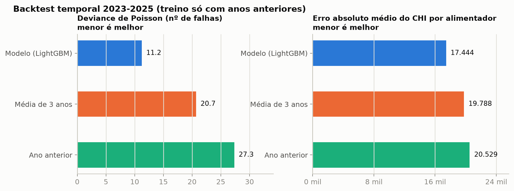
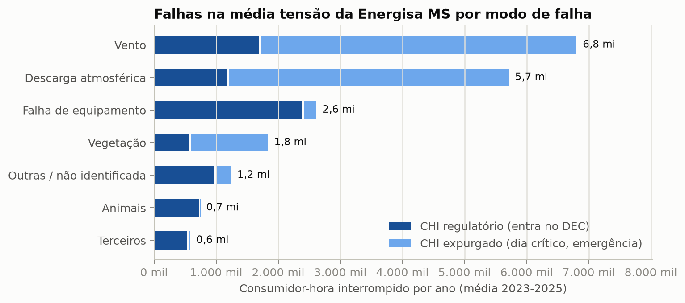
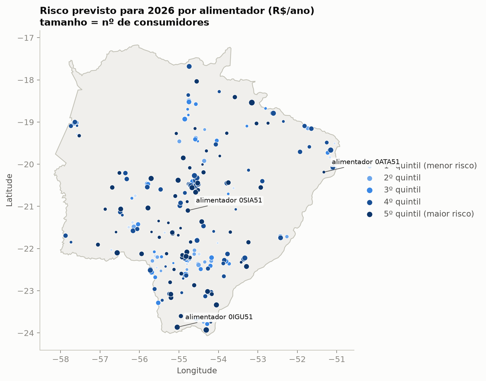
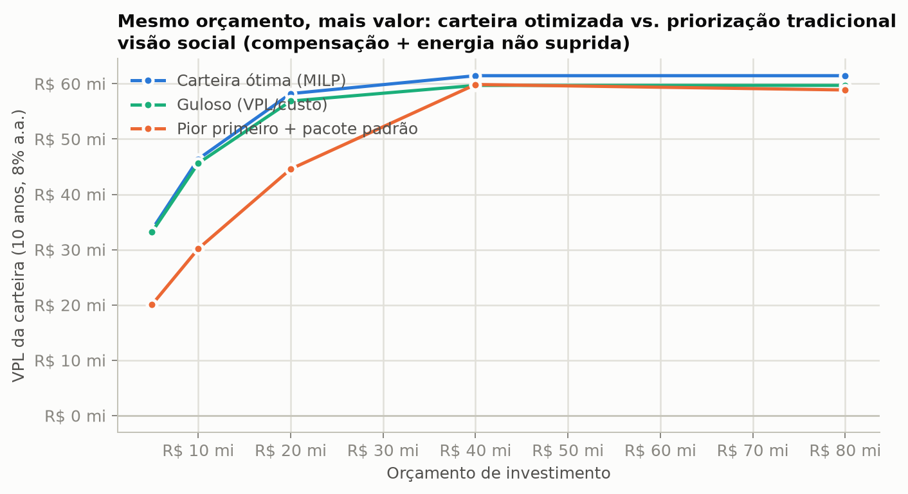

# Resultados para a Energisa MS (EMS)

Os mesmos métodos já publicados para a Energisa MT, aplicados à **Energisa Mato Grosso do Sul** (código ANEEL 404) com
dados abertos da ANEEL e do IBGE. Todo número desta página sai de arquivo regenerado em `reports/ems/` ou em
`data/ems/` (execução de 06/11/2026), e cada decisão de dado foi registrada em
[`decisoes_ems.md`](decisoes_ems.md) **antes** de qualquer resultado do modelo. As saídas que os outros repositórios
leem estão em [`saidas_ems.md`](saidas_ems.md).

> Projeto independente, sem vínculo com a Energisa ou com a ANEEL. A carteira de investimento é uma simulação sob
> premissas ilustrativas (as mesmas de MT), não um ganho observado em campo. Os números de MS e de MT são comparados
> aqui só de forma descritiva, por consumidor e por km, sem afirmar causas.

**Tamanho do recorte (BDGD de 31/12/2025):** 362 alimentadores, 1.404.395 consumidores e 91.453 km de rede de média
tensão. As interrupções vão de 2018 a julho de 2026 (1,47 milhão de registros da EMS).

## 1. A base reproduz o DEC oficial, com duas exceções

Recalculei o DEC e o FEC a partir das interrupções individuais (sem expurgo e com 3 minutos ou mais), como em MT
([`reports/ems/validacao_dec_fec.csv`](../reports/ems/validacao_dec_fec.csv)):

| Ano | DEC oficial | DEC recalculado | FEC oficial | FEC recalculado |
|---|---|---|---|---|
| 2020 | 10,00 | 10,00 | 4,31 | 4,31 |
| 2021 | 10,23 | 9,01 | 4,27 | 3,92 |
| 2022 | 9,62 | 9,61 | 4,23 | 4,23 |
| 2023 | 9,29 | 9,28 | 3,99 | 3,99 |
| 2024 | 9,03 | 9,03 | 4,25 | 4,25 |
| 2025 | 9,13 | 9,12 | 4,33 | 4,32 |
| 2026 (jan a jul) | 4,74 | 3,94 | 2,25 | 1,94 |

De 2022 a 2025 e em 2020 a diferença é de no máximo 0,01 h. **Em 2021 e em 2026 não bate**, por causa de dois meses
(detalhes na seção 3.4 de [`decisoes_ems.md`](decisoes_ems.md)): outubro de 2021, em que o regulador contabilizou CHI de
uma situação de emergência que o arquivo de interrupções marca como expurgado, e março de 2026, que não tem nenhum
registro no arquivo de interrupções. Sem esses dois meses a correlação mensal por conjunto é de 0,9994 (com eles,
0,9596). Os anos de teste do modelo (2023 a 2025) estão entre os que batem.

## 2. Comparação com baselines de planejamento

Backtest temporal com origem móvel, como em MT: para prever 2023, o modelo só vê dados até 2022, e assim por diante;
as características cadastrais e o vínculo de circuitos usam só snapshots da BDGD até 31/12 do ano anterior.



| Métrica (média 2023-2025) | Modelo | Média de 3 anos | Ano anterior |
|---|---|---|---|
| Deviance de Poisson (nº de falhas por alimentador e modo) | **11,2** | 20,7 | 27,3 |
| Erro absoluto do CHI por alimentador | **17,4 mil** | 19,8 mil | 20,5 mil |
| Correlação de Spearman do ranking de CHI | **0,87** | 0,83 | 0,83 |
| CHI capturado pelos 10% de alimentadores priorizados | 31% | 30% | 31% |

**O que isso significa:** como em MT, o modelo ganha mais onde o histórico não ajuda, que é dizer **qual modo de falha**
vai pesar em cada alimentador (deviance 1,8 vez menor que a da média de 3 anos; em MT, 2,5 vezes). O erro do CHI por
alimentador é 12% menor que o da média de 3 anos e 15% menor que o do ano anterior. Para saber *quais* alimentadores
são os piores, o ganho é pequeno (Spearman de 0,87 contra 0,83) e os 10% priorizados capturam praticamente o mesmo
CHI com o modelo e com o histórico. A calibração por decil está em
[`reports/ems/figures/06_calibracao.png`](../reports/ems/figures/06_calibracao.png).

**Variação entre sementes.** Os números da tabela são da semente 0 do LightGBM, como no README de MT. Repeti o backtest
com as sementes 0 a 9 ([`scripts/variacao_sementes.py`](../scripts/variacao_sementes.py),
[`reports/ems/variacao_sementes.json`](../reports/ems/variacao_sementes.json)); o desvio-padrão é o das médias de 2023 a 2025
entre as 10 sementes:

| Modelo, média 2023-2025 | Média de 10 sementes | Desvio-padrão | Mínimo a máximo |
|---|---|---|---|
| Deviance de Poisson (falhas) | 11,22 | 0,03 (0,3%) | 11,17 a 11,27 |
| Erro absoluto do CHI por alimentador | 17.538 | 104 (0,6%) | 17.361 a 17.657 |
| Spearman do ranking de CHI | 0,871 | 0,001 | 0,868 a 0,873 |
| CHI capturado pelos 10% priorizados | 31,4% | 0,2 ponto | 31,2% a 31,7% |

Mudar a semente ou a ordem das linhas do painel move o erro do CHI em ~0,6%, então reproduzir em outra máquina pode mudar
o último dígito das métricas do modelo. As diferenças entre o modelo e os baselines (12% a 15% no erro do CHI) são
maiores que isso; as de captura dos 10% priorizados, não.

## 3. Onde está o risco



Falhas de média tensão (internas e não programadas), média de 2023 a 2025
([`chi_por_modo.csv`](../reports/ems/diagnostico/chi_por_modo.csv)):

| Modo de falha | CHI por ano | Parte do CHI | CHI expurgado |
|---|---|---|---|
| Vento | 6,8 milhões | 34,8% | 75% |
| Descarga atmosférica | 5,7 milhões | 29,3% | 79% |
| Falha de material ou equipamento | 2,6 milhões | 13,4% | 9% |
| Vegetação | 1,8 milhão | 9,4% | 69% |
| Outras / não identificada | 1,2 milhão | 6,4% | 22% |
| Animais | 0,7 milhão | 3,8% | 2% |
| Terceiros | 0,6 milhão | 3,0% | 9% |

* **59% do CHI é expurgado** (dia crítico e situação de emergência), contra 26% em MT. Nos modos ligados ao tempo (vento,
  descarga, vegetação) a fração expurgada vai de 69% a 79%. Esse CHI pesa para o cliente, mas não entra no DEC nem gera
  compensação; o modelo trata as duas contas separadamente.
* **O risco é menos concentrado que em MT.** Os 10% de alimentadores de maior risco concentram **33%** do risco
  monetizado previsto para 2026 (46% em MT) e os 20% de maior risco, 50% (66% em MT).
* **Tamanho do problema em 2026:** R$ 16,6 mi/ano de risco em compensações, R$ 106,0 mi/ano na visão social (depende do
  custo da energia não suprida, premissa) e 5,9 h de DEC previsto por falhas de MT.
* As variáveis que mais pesam na previsão do CHI (SHAP) são o próprio modo de falha, o número de consumidores e o CHI do
  ano anterior ([`reports/ems/shap_importancia_chi.csv`](../reports/ems/shap_importancia_chi.csv)).



### Comparação descritiva com MT, normalizada

| | Energisa MT | Energisa MS |
|---|---|---|
| Alimentadores | 697 | 362 |
| Consumidores por km de rede MT | 9,8 | 15,4 |
| CHI previsto para 2026 por consumidor | 11,5 | 14,6 |
| CHI previsto para 2026 por km de rede MT | 113 | 224 |
| DEC previsto por falhas de MT (h) | 8,5 | 5,9 |
| Risco social previsto (R$ por consumidor por ano) | 74,2 | 75,5 |
| Risco em compensações (R$ por consumidor por ano) | 17,2 | 11,8 |

Os valores de MT vêm de `app/data/risco_alimentador.parquet` (publicado) e os de MS, de
`data/ems/processed/risco_alimentador.parquet` (o mesmo de `app/data/ems/`); a conta está em
[`comparacao_descritiva.csv`](../reports/ems/diagnostico/comparacao_descritiva.csv). É uma tabela descritiva: não explica por que os valores diferem, e os dois
conjuntos de dados têm particularidades diferentes (por exemplo, a fração de CHI expurgado).

## 4. Comparação de carteiras sob premissas ilustrativas

Mesmo método e mesmas premissas de MT: pacotes de até 3 intervenções por alimentador (religador, automação, rede
compacta, para-raios, poda e manutenção preditiva), combinados de forma multiplicativa por modo de falha, e uma carteira
escolhida por programação inteira para maximizar o VPL dentro do orçamento
([`configs/intervencoes.yaml`](../configs/intervencoes.yaml), custos e eficácias **ilustrativos**).



Com orçamento de **R$ 20 milhões**, na visão social (compensação + energia não suprida):

| Estratégia | VPL em 10 anos | DEC evitado | Alimentadores tratados |
|---|---|---|---|
| **Carteira ótima (MILP)** | **R$ 58,2 mi** | 0,51 h | 87 |
| Heurística gulosa (VPL/custo) | R$ 56,9 mi | 0,51 h | 90 |
| Tradicional: piores alimentadores primeiro + pacote padrão | R$ 44,6 mi | 0,47 h | 66 |

A carteira ótima vale **1,3 vez** a da regra tradicional (em MT, 2,3 vezes). O mix da carteira ótima é de 75
religadores e 15 automações. A vantagem sobre a regra tradicional **encolhe quando o orçamento cresce**, porque o
otimizador só escolhe pacotes de VPL positivo e para de investir em R$ 31,8 mi:

| Orçamento | Ótima: VPL (investido) | Gulosa | Tradicional | Ótima ÷ tradicional |
|---|---|---|---|---|
| R$ 5 mi | R$ 33,6 mi (R$ 5,0 mi) | R$ 33,2 mi | R$ 20,1 mi | 1,68 |
| R$ 10 mi | R$ 46,4 mi (R$ 10,0 mi) | R$ 45,6 mi | R$ 30,2 mi | 1,54 |
| R$ 20 mi | R$ 58,2 mi (R$ 20,0 mi) | R$ 56,9 mi | R$ 44,6 mi | 1,31 |
| R$ 40 mi | R$ 61,4 mi (R$ 31,8 mi) | R$ 59,7 mi | R$ 59,9 mi | 1,03 |
| R$ 80 mi | R$ 61,4 mi (R$ 31,8 mi) | R$ 59,7 mi | R$ 58,9 mi | 1,04 |

Na **visão de caixa** (só compensações), apenas **R$ 3,8 mi** de obras (24 alimentadores) têm VPL positivo, e o VPL é
de R$ 1,4 mi. A priorização tradicional tem VPL negativo em qualquer orçamento: −R$ 4,9 mi com R$ 19,9 mi investidos e
−R$ 17,3 mi com R$ 41,9 mi. Ou seja, a compensação regulatória sozinha não paga quase nenhum investimento em
confiabilidade em MS (em MT, R$ 21 mi), mesmo quando a ótima deixa de gastar o orçamento.

> **Premissas.** Custos, eficácias e custo da energia não suprida são os mesmos de MT e **não foram calibrados para MS**.
> A elegibilidade de cada intervenção, porém, depende do cadastro de MS (religador: 28% dos alimentadores; automação:
> 22%; ver [`decisoes_ems.md`](decisoes_ems.md), seção 5). O valor absoluto do VPL serve para comparar estratégias, não
> para aprovar verba. A sensibilidade com eficácias medidas **não foi feita para MS**: depende do efeito do religador
> medido pelo `automation-impact` em MS, que ainda não existe.

## 5. Robustez

* **Cortes temporais.** Rodei o backtest com e sem os cortes temporais no vínculo de circuitos
  ([`scripts/ablacao_point_in_time.py`](../scripts/ablacao_point_in_time.py)): o modelo com cortes
  (*point-in-time*) tem erro do CHI de 17.444 contra 17.839 sem cortes (−2,2%), a deviance de Poisson vai de 11,14 para
  11,24 (+0,9%) e o ranking de CHI vai de 0,866 a 0,872. Em MT, os cortes pioravam o erro em 2,6%; em MS o sentido é o
  oposto e não investiguei por quê. Uma diferença de 2% é maior que o desvio entre sementes (0,6%), mas é uma só
  execução. Os baselines não mudam.
* **Clima do INMET:** não foi usado nem testado em MS (ver `decisoes_ems.md`).
* **Checagem parcial de 2026.** A previsão de 2026 comparada com as falhas observadas de janeiro a julho tem Spearman de
  **0,66** no ranking de falhas e a captura dos 10% priorizados é de 20% ([`resultados.json`](../reports/ems/resultados.json));
  em MT, o Spearman é de 0,83. Há particularidades dos dados de 2026 de MS que podem pesar nessa checagem, **sem que eu
  tenha medido quanto**: o arquivo não tem **março**, a categoria "falha nas instalações da UC" passa a 8,8% das falhas
  (3,5% em 2025 e zero antes) e 14% das falhas de 2026 não casam com nenhum circuito da BDGD publicada. Não afirmo causa
  para a diferença em relação a MT. Trate esse número como um alerta, e não como medida de qualidade do modelo.

## 6. Painel interativo

O painel Streamlit do repositório tem um seletor de distribuidora (barra lateral) que troca entre MT e MS, com os
mesmos mapa de risco, carteira por orçamento e detalhe por alimentador:

```bash
pip install -e ".[app]"
streamlit run app/app.py
```

Os Parquet de MS ficam em `app/data/ems/` (4 arquivos, 0,8 MB).

## 7. Limitações

* **Premissas ilustrativas.** Custos, eficácias e custo social vêm de MT, sem calibração para MS. As eficácias medidas
  em MT (`automation-impact`) não foram aplicadas a MS.
* **Buracos e quebras nos dados.** Março de 2026 sem registros; outubro de 2021 com CHI de emergência contado pelo
  regulador e marcado como expurgado no arquivo; categoria de falha nova a partir de 2025; layout novo de 2026 com
  outras proporções de causa (`decisoes_ems.md`, seções 3.4 e 3.5).
* **Mais CHI expurgado, menos CHI regulatório.** 59% do CHI das falhas de MS é expurgado (26% em MT), então a visão de
  caixa, que só usa o CHI regulatório, cobre uma parte menor do problema.
* **Vínculo de circuitos.** Os anos de treino de 2019 e 2020 têm só 79% das falhas ligadas a um circuito (como em MT);
  2026 tem 86% e serve só de checagem parcial.
* **O modelo varia de uma semente para outra** (0,6% no erro do CHI) e **prioriza, não prevê o DEC do ano**.
* **A compensação média por CHI** é uma aproximação linear de uma regra não linear.

## Como reproduzir

```bash
export GRIDRISK_CONFIG=configs/ems.yaml      # ou passe --config configs/ems.yaml a cada script
python scripts/build_interrupcoes.py
python scripts/build_bdgd.py                  # 8 snapshots, um por vez
python scripts/build_continuidade.py          # indicadores e compensações da ANEEL
python scripts/run_pipeline.py                # backtest, previsão 2026, SHAP, risco e carteira
python scripts/validate_dec.py --alinhar-meses --mensal
python scripts/resumo_decisao.py
python scripts/variacao_sementes.py
python scripts/ablacao_point_in_time.py
python scripts/make_figures.py
```

Nesta execução, os downloads (BDGD e arquivos da ANEEL) vieram de um cache local de arquivos já baixados e conferidos, e
os dois arquivos de continuidade foram copiados desse cache para `data/ems/raw/continuidade/` em vez de baixados de novo
por `build_continuidade.py`; são os mesmos arquivos da ANEEL. Tudo foi gravado em `data/ems/`, `reports/ems/` e
`app/data/ems/`, sem tocar nos resultados de MT.
